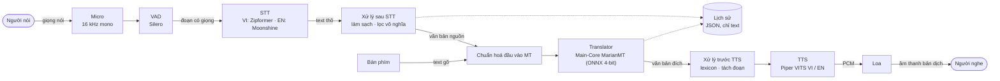
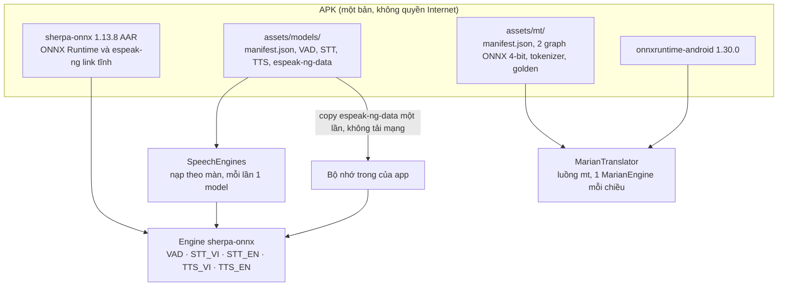

# Kiến trúc AppProduct

Tài liệu này mô tả thiết kế của app (khung app, STT, MT, TTS, hội thoại, lịch sử),
cập nhật theo code ngày 2026-10-07. Bố cục theo mục 3.1 của dàn ý báo cáo
(`Documents/suggest báo cáo.docx`: người dùng → STT → MT → TTS → người dùng,
cùng model storage, runtime offline và xử lý lỗi) để dùng lại cho chương 3.

## 1. Luồng chính

- Chiều dịch luôn chọn rõ: thanh "[nguồn] ⇄ [đích]" ở màn Dịch nhanh; mỗi
  người một nút nói theo ngôn ngữ của mình ở màn Hội thoại. Không tự nhận diện
  ngôn ngữ.
- Bộ dịch là Main-Core Phase 03 của Core (Student MarianMT, mỗi chiều một model),
  chạy offline bằng ONNX Runtime ([mt_package_v2.md](contracts/mt_package_v2.md)).
  Khi chưa dựng gói MT: không có bộ dịch, hiện banner và chỉ hiện câu gốc. Không tạo
  bản dịch giả.
- Lịch sử lưu toàn bộ dạng text, không lưu audio; "Nghe lại" là TTS đọc lại text
  ([DR-06](decisions/DR-06_lich_su.md)).

## 2. Chuỗi xử lý văn bản

| Bước | Class | Việc |
|---|---|---|
| Sau STT | `SttPostProcessor` | NFC, gộp khoảng trắng; zipformer-vi xuất chữ HOA nên chuyển thường theo locale vi rồi viết hoa chữ đầu (Moonshine giữ nguyên); bỏ từ đệm, gộp từ lặp ≥ 3 lần (bật/tắt, TN-03); bỏ kết quả rỗng hoặc chỉ có từ đệm |
| Trước MT | `MtInputNormalizer` (`phase01_nfc_whitespace_v1`) | Luôn chạy, không tắt được; parity với `norm()` của Core ([mt_package_v2.md](contracts/mt_package_v2.md)) |
| MT | `MarianTokenizer` (SentencePiece unigram Kotlin), `MarianEngine`, `BeamSearch` | `>>vie<<` cho EN→VI; beam 4 (EN→VI) / 6 (VI→EN) như `generation_config`; câu > 512 token tách theo câu, không cắt |
| Trước TTS | `TtsTextNormalizer` (lexicon `assets/text/tts_lexicon_vi.tsv`, `chunks()`) | Lexicon IT cho giọng Việt (bật/tắt, TN-07); viết tắt HOA đọc theo tên chữ cái; `3.12` → "3 chấm 12" / "3 point 12"; tách camelCase, snake_case; tách câu tại dấu câu rồi ≤ 25 từ |

## 3. Lưu model và runtime offline

- **Model trong APK:** mọi model nằm trong assets, không tải lần đầu. File do
  `tools/fetch_artifacts.py` tải trên PC theo `artifacts.lock.json` (kiểm
  SHA-256) và sinh `assets/models/manifest.json`. App đọc vai trò model từ
  manifest này, không hardcode tên file.
- **Runtime:** `sherpa-onnx-static-link-onnxruntime-1.13.8.aar` (vendored, ghim
  SHA-256, không commit). ONNX Runtime link tĩnh vào JNI của sherpa nên app thêm
  `onnxruntime-android` 1.30.0 cho bộ dịch mà không trùng thư viện (chỉ phải bỏ file
  32-bit thừa trong AAR sherpa). Ghim 1.13.x vì bản 2.0 bỏ espeak-ng.
- **Bộ dịch:** `MarianTranslator` nạp model từ `assets/mt/` theo màn (Dịch nhanh: 1 chiều,
  Hội thoại: 2 chiều), giải phóng khi app vào nền (`onTrimMemory`). RAM đo trên AVD:
  657–722 MB PSS khi đủ 4 model giọng nói + 2 model dịch.
- **Đóng gói:** model để nén trong APK (giải nén khi nạp, chạy nền); bản release dùng R8 với keep rule
  `com.k2fsa.sherpa.onnx.**`, `ai.onnxruntime.**`; `GIT_SHA` trong `BuildConfig`; task Gradle
  `verifyArtifacts` báo lỗi rõ khi chưa chạy script tải model.
- **ABI:** `arm64-v8a` và `x86_64` (emulator), bật ABI split. Không hỗ trợ máy
  32-bit.

## 4. Bản build

Từ 2026-10-07 chỉ còn **một bản** (bỏ flavor `dev` dùng ML Kit,
[DR-09](decisions/DR-09_thu_gon_app.md)):

| | Giá trị |
|---|---|
| applicationId | `vn.viettechtrans.app` |
| Quyền | Chỉ `RECORD_AUDIO`. INTERNET và ACCESS_NETWORK_STATE bị xoá bằng `tools:node="remove"` trong `src/main/AndroidManifest.xml` (kể cả khi thư viện kéo vào) |
| Bộ dịch | Main-Core MT trong `assets/mt/`; thiếu gói thì không có bộ dịch (banner, chỉ hiện câu gốc) |
| Lệnh | `:app:testDebugUnitTest`, `:app:assembleRelease "-Pvtt.abis=arm64-v8a,x86_64"` |

## 5. Thành phần trong code (module `:app`)

| Package | Vai trò |
|---|---|
| `mt/` | `Lang`, `Direction`, `Translator`, `MtInputNormalizer`, `MtPackageManifest` + validator, `CoreMtProvider`, `TranslatorRegistry` |
| `mt/marian/` | `SentencePiece`, `MarianTokenizer`, `MarianEngine` (ONNX Runtime), `BeamSearch`, `MarianTranslator` |
| `speech/` | `SpeechEngines` (nạp/giải phóng engine sherpa-onnx), `Listener` + `ListenSession` (VAD, hết lượt), `Speaker`, `EspeakDataInstaller`, `ModelManifest` |
| `audio/` | `MicRecorder`, `PcmPlayer` |
| `text/` | `SttPostProcessor` (làm sạch, lọc vô nghĩa), `TtsTextNormalizer` |
| `turn/` | `ConversationReducer` (`reduce(state, event)` thuần, test trên JVM), `TurnRunner` (nghe → làm sạch → dịch → đọc), `TurnTimings` |
| `history/` | `ConversationStore`: mỗi cuộc trò chuyện một file JSON |
| `diagnostics/` | `DeviceCheck` (Cài đặt → Kiểm tra máy này); `Diagnostics.kt` ghi lý do thoát và lỗi gần nhất |
| `ui/` | Compose: Hội thoại (+ ngăn ☰ `HistoryDrawer`), Dịch nhanh, Cài đặt, Hướng dẫn |

DI thủ công (`AppContainer`); kotlinx.serialization; coroutines.

## 6. Luồng chạy (thread)

| Luồng | Việc |
|---|---|
| main | Chỉ UI |
| Thu âm | Đọc `AudioRecord` (VOICE_RECOGNITION, 16 kHz mono) |
| Phát âm | Ghi `AudioTrack` |
| Engine giọng nói | Mỗi engine (VAD, STT, TTS) chạy trên dispatcher riêng; một luồng TTS cho cả hai giọng vì espeak-ng giữ trạng thái toàn cục |
| Bộ dịch | ONNX Runtime 2 luồng mỗi chiều |
| ViewModel | Reducer chạy tuần tự trên main; effect chạy trong coroutine |
| IO | Lưu lịch sử (`Dispatchers.IO` + `Mutex`), copy espeak-ng-data |

## 7. Model nạp theo màn hình

| Màn | Bộ model |
|---|---|
| Dịch nhanh (chiều d) | VAD, STT[nguồn của d], TTS[đích của d], MT[d] |
| Hội thoại | VAD, STT_VI, STT_EN, TTS_VI, TTS_EN, MT cả hai chiều |

- Khi màn hiện ra, `retainOnly` giải phóng model ngoài bộ và nạp nền các model còn thiếu,
  mỗi lần một model.
- `TRIM_MEMORY_BACKGROUND` trở lên, `TRIM_MEMORY_RUNNING_CRITICAL` hoặc low memory:
  dừng đọc và giải phóng hết (`VttApplication.onTrimMemory`).

## 8. Xử lý lỗi

Bảng đầy đủ (20 trường hợp, kèm việc người dùng cần làm):
[bao_cao/quy_trinh_va_xu_ly_loi.md](bao_cao/quy_trinh_va_xu_ly_loi.md). Tóm tắt:

| Tình huống | App làm gì |
|---|---|
| Không nghe thấy giọng | 6 s không có giọng thì báo "Không nghe thấy giọng nói" |
| Chỉ có từ đệm | Bỏ, không tạo câu |
| Nhận sai | Bấm ✎ trên câu, sửa, "Dịch lại"; câu được thay (nhãn "đã sửa") |
| Quá dài | Lượt tối đa 60 s thì tự kết thúc; chữ gõ tối đa 500 ký tự hiển thị (khoá gửi, không cắt chữ, R02); câu > 500 `source_ids` tách theo câu rồi dấu cách, không tách trong URL/code (R09) |
| MT chậm | Sau 10 s báo "Mô hình dịch chưa phản hồi…" |
| MT lỗi | Câu có nhãn "dịch lỗi", sửa và dịch lại được |
| Chưa có quyền mic | "Cần quyền micro để nói. Bạn vẫn gõ được." |
| Chưa có bộ dịch | Banner "Chưa có mô hình dịch trong bản cài này…", chỉ hiện câu gốc; không có bản dịch giả |
| Cuộc trò chuyện đủ 500 câu | Báo, gợi ý bấm ＋ |

## 9. Máy trạng thái lượt nói

- **Trạng thái:** `Idle | Listening(p, t) | Processing(p, t) | Speaking`, cộng tập
  lượt chạy nền (lượt bị cắt).
- **Nút nói:** chạm để bắt đầu, chạm lại để dừng. Lượt cũng tự kết thúc khi im
  lặng 1,5 s hoặc đủ 60 s.
- **Half-duplex:** mic tắt khi TTS đọc; chạm để dừng đọc.
- **Chen lời chỉ theo cách Cắt** (quy tắc Chờ và luân phiên tự động đã bỏ, DR-09):

| Tình huống | App làm gì |
|---|---|
| B chạm khi A đang nói | Lượt A chạy nền (vẫn STT → MT → lưu, nhưng không phát, nhãn "chưa phát"). Mic chuyển sang B ngay |
| Ai đó chạm khi TTS đang đọc | Dừng đọc (nhãn "bị ngắt"), mở mic cho người chạm |
| TTS đọc xong | Về Idle |
| Sửa câu (✎) khi Idle hoặc đang đọc | Dừng đọc nếu có, thay câu gốc (qua rule R01–R07 như chữ gõ), dịch lại; không tự đọc, bấm 🔊 để nghe (R13) |
| Gõ câu (⌨) | Qua rule R01–R07 (giữ nguyên R03/R04, hỏi R06 khi có vẻ là ngôn ngữ kia), dịch, kiểm tra R08/R12; không tự đọc, dòng thời gian chỉ "MT … ms" (R13) |
| Sửa câu khi đang nghe hoặc đang dịch | Báo "Đợi lượt đang nói hoặc đang dịch xong rồi sửa" |
| Chuyển cuộc trò chuyện (＋, mở cuộc khác) | Dừng mic và đọc, về Idle; kết quả muộn của cuộc cũ bị bỏ |

Màn Dịch nhanh dùng một người và luôn theo quy tắc Cắt. Nói chồng (người kia nói vào
lúc mic của A đang mở) không tách được với một micro: lời nói đó vào lượt của A; ghi
rõ trong Hướng dẫn.

**Bất biến**, kiểm bằng fuzz test 10 000 chuỗi sự kiện:

1. Mic mở thì không có TTS phát.
2. Tối đa một người ở trạng thái `Listening`.
3. Mỗi lượt kết thúc đúng một lần và được lưu tối đa một lần.
4. Lượt đã bỏ phát thì không bao giờ phát.

## Cập nhật 2026-10-07: thu gọn app

- Màn chính là **Hội thoại** (khung chat): bong bóng Việt bên trái, Anh bên phải;
  dưới cùng 🎤 Tiếng Việt · ⌨ · 🎤 English. Mỗi câu có 🔊 nghe lại và ✎ sửa.
- **☰** mở danh sách cuộc trò chuyện (Hôm nay / Hôm qua / 7 ngày / 30 ngày / Cũ hơn,
  đổi tên, xoá), Dịch nhanh, Hướng dẫn, Cài đặt. **＋** tạo cuộc mới.
- Đã bỏ: thanh điều hướng dưới, màn Thực nghiệm, bố cục chia đôi, luân phiên tự động,
  quy tắc Chờ, bản `dev` ([DR-09](decisions/DR-09_thu_gon_app.md)). Bản 2026-10-02
  ở [DR-05](decisions/DR-05_hoi_thoai_chen_loi.md) giữ để tham khảo.
