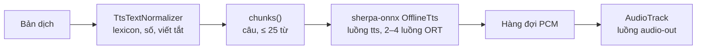

# DR-04 — Giọng đọc (TTS): Piper VITS, chỉ nén trọng số

**Trạng thái:** đã chốt · **Ngày:** 2026-10-07 · **Người viết:** Đạt (Claude soạn) ·
**Liên quan:** `speech/SpeechEngines.kt`, `speech/Speaker.kt`, `text/TtsTextNormalizer.kt`,
`tools/tts/piper_weight_only.py`, `tools/tts/compare_piper.py`, `artifacts.lock.json`

## 1. Bối cảnh & ràng buộc

- App đọc bản dịch bằng giọng của ngôn ngữ đích, chạy offline bằng sherpa-onnx 1.13.8 (ONNX Runtime
  link tĩnh). Giọng: Piper VITS medium `vi_VN-vais1000` và `en_US-ljspeech` (22 050 Hz).
- Từ 2026-10-01 app dùng bản "-int8" do k2-fsa phát hành (19 MB thay 63 MB mỗi giọng) để APK nhẹ.
- Thử trên điện thoại thật (2026-10-07): đọc **lâu**, nghe **đứt đoạn** và **chưa rõ**.

## 2. Định nghĩa

- **RTF** (real-time factor): thời gian tổng hợp / độ dài âm thanh. RTF ≥ 1 thì câu sau chưa tổng hợp
  xong khi câu trước đã phát hết → khoảng lặng giữa các đoạn (đứt đoạn).
- **Lượng tử hoá động** (k2-fsa "-int8"): trọng số int8 và **tín hiệu cũng lượng tử hoá lúc chạy**
  (`DynamicQuantizeLinear` + `ConvInteger`).
- **Chỉ nén trọng số** (weight-only int8): trọng số lưu int8 theo từng kênh, `DequantizeLinear` trả về
  float; mọi phép Conv vẫn chạy float như bản gốc.

## 3. Quy trình hoạt động

Đoạn sau được tổng hợp trong lúc đoạn trước đang phát; nếu RTF gần hoặc vượt 1 thì nghe đứt đoạn.

## 4. Ứng viên

Đo bằng `python -I tools/tts/compare_piper.py` (PC i5-12500H, ONNX Runtime 1.30, 2 luồng, cùng chuỗi
âm vị; LSD = độ lệch phổ log so với fp32 sau khi căn DTW):

| Giọng | Bản | Dung lượng | RTF | LSD so với fp32 | Độ dài so với fp32 |
|---|---|---|---|---|---|
| vi | fp32 gốc | 63,1 MB | 0,17 | 0 | 1 |
| vi | k2-fsa int8 động (cũ) | 18,6 MB | 0,50 | 20,3 dB | 0,995 |
| vi | **chỉ nén trọng số** | **18,3 MB** | **0,18** | **4,9 dB** | **1,000** |
| en | fp32 gốc | 63,5 MB | 0,14 | 0 | 1 |
| en | k2-fsa int8 động (cũ) | 19,3 MB | 0,49 | 9,1 dB | 0,981 |
| en | **chỉ nén trọng số** | **18,7 MB** | **0,16** | **5,4 dB** | **1,002** |

Trong app (AVD Pixel_10a, "Kiểm tra máy này", cùng câu): RTF VI 0,20 → 0,12, EN 0,22 → 0,08; nghe lại
bằng STT vẫn đúng cả hai câu; RAM app khi đủ 6 mô hình 722 → 687 MB (PSS).

## 5. Tiêu chí

Nhanh (RTF thấp trên điện thoại), giữ giọng gần bản gốc, APK không lớn thêm, chạy được trên
sherpa-onnx 1.13.8 hiện có (không đổi runtime).

## 6. Ứng viên được chọn

Bản fp32 gốc của k2-fsa (`vits-piper-*-medium.tar.bz2`, ghim SHA-256 trong `artifacts.lock.json`),
chuyển bằng `tools/tts/piper_weight_only.py` khi chạy `fetch_artifacts.py` (bước `derive`, kết quả
cũng ghim SHA-256).

## 7. Lý do chọn & thiết kế tích hợp

- Bản int8 động chậm vì `ConvInteger` của ONNX Runtime là đường chạy chậm và phải lượng tử hoá cả
  tín hiệu âm thanh mỗi lần; lượng tử hoá tín hiệu cũng làm giọng lệch xa bản gốc (vi 20 dB).
- Chỉ nén trọng số: Conv/ConvTranspose có ≥ 4096 phần tử, int8 đối xứng theo kênh ra (ConvTranspose
  theo trục 1). Giữ float cho bộ dự đoán trường độ (`/dp/`) để nhịp đọc y như bản gốc (độ dài ×1,000).
  Không đổi metadata (sherpa-onnx đọc `sample_rate`, `has_espeak`…).
- `fetch_artifacts.py` thêm kiểu `derive` cho một file: kiểm SHA-256 của file trong archive, chạy công
  cụ, rồi kiểm SHA-256 của kết quả. Công cụ chạy bằng chính trình thông dịch (cần numpy + onnx của .venv).
- Code app không đổi (vẫn `OfflineTtsVitsModelConfig`).

## 8. Ưu điểm

- Nhanh hơn bản cũ 2,8–3,5 lần trên PC, 1,7–2,8 lần trong app; gần giọng gốc hơn nhiều.
- APK chỉ tăng khoảng 4 MB (file trong APK nén kém hơn một chút); RAM giảm.

## 9. Nhược điểm & rủi ro

| Rủi ro | Cách giảm |
|---|---|
| `DequantizeLinear` chạy lại mỗi lần tổng hợp (khoảng 15 triệu trọng số) | Đo: vẫn gần fp32 (RTF 0,18 so với 0,17) |
| Điện thoại yếu vẫn có RTF gần 1 | "Kiểm tra máy này" báo RTF; nếu cần: bỏ tách câu đầu ở dấu phẩy, giảm số luồng tranh chấp |
| LSD đo trên chuỗi âm vị ngẫu nhiên, không phải câu thật | Chỉ dùng để so các bản với nhau; nghe thử trên máy thật |

## 10. Kiểm chứng

- `python -I tools/tts/compare_piper.py` (bảng mục 4).
- `python tools/fetch_artifacts.py --record` rồi `--verify` → `APP_ARTIFACTS=PASS`; chuyển đổi chạy hai lần
  ra cùng SHA-256.
- AVD: "Kiểm tra máy này" (số ở mục 4); `gradlew :app:testDebugUnitTest` 67/67.

## 11. Nguồn

1. Piper voices: <https://huggingface.co/rhasspy/piper-voices>
2. Bản sherpa-onnx: <https://github.com/k2-fsa/sherpa-onnx/releases/tag/tts-models>
3. ONNX `DequantizeLinear` (per-axis): <https://onnx.ai/onnx/operators/onnx__DequantizeLinear.html>
