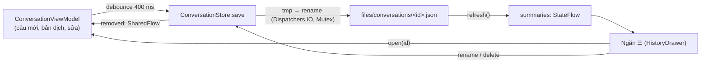

# DR-06 — Lịch sử cuộc trò chuyện

**Trạng thái:** đã chốt · **Ngày:** 2026-10-07 · **Người viết:** Đạt (Claude soạn) ·
**Liên quan:** DR-05, DR-09; `history/ConversationStore.kt`,
`ui/conversation/{ConversationViewModel,HistoryDrawer}.kt`

## 1. Bối cảnh & ràng buộc

- Yêu cầu mới (2026-10-07): lưu lịch sử và tạo cuộc trò chuyện mới "như ChatGPT".
  Sketch2 đã yêu cầu kho lưu trữ chỉ để xem và nghe lại; người dùng chốt **chỉ lưu
  chữ, không lưu audio** (kế hoạch giai đoạn A). "Nghe lại" đọc lại bản dịch bằng TTS.
- App offline, cần nhẹ: hạn chế thêm thư viện và dung lượng APK.
- Dữ liệu nhỏ: một câu gồm câu gốc, bản dịch và vài mốc thời gian, khoảng 1 KB.
  Mỗi cuộc tối đa 500 câu (khoảng 0,5 MB).
- Thao tác cần có: liệt kê (mới nhất trước), mở, nói tiếp, sửa câu, đổi tên, xoá
  một cuộc, xoá tất cả. Không cần tìm kiếm hay lọc theo cột.

## 2. Định nghĩa

- **Cuộc trò chuyện:** danh sách câu của hai người (A = Tiếng Việt, B = English),
  có id, tiêu đề, thời điểm tạo và sửa cuối.
- **Ghi nguyên tử (atomic write):** ghi ra file tạm rồi đổi tên đè file cũ; nếu
  tắt máy giữa chừng thì file cũ vẫn nguyên.
- **Tombstone:** danh sách id vừa bị xoá, để một lần lưu đang trên đường không làm
  cuộc đã xoá xuất hiện lại.

## 3. Quy trình hoạt động

- Cuộc mới chỉ có id khi có câu đầu tiên, nên bấm ＋ nhiều lần không tạo file rỗng.
- Tiêu đề lấy dòng đầu của câu đầu tiên (tối đa 60 ký tự) cho đến khi người dùng đổi tên.
- Khi chuyển cuộc (＋, mở cuộc khác, cuộc đang mở bị xoá), VM tăng `epoch`; kết quả
  nhận dạng hoặc dịch muộn của cuộc cũ bị bỏ qua.
- App bị đóng khi một câu đang dịch: mở lại thì câu đó hiện nhãn "dịch lỗi" và sửa
  được (✎ → Dịch lại).

## 4. Ứng viên

| Ứng viên | Thêm vào APK | Phụ thuộc mới | Phù hợp |
|---|---|---|---|
| Room (SQLite) + Paging | khoảng 1–2 MB, thêm KSP vào build | Room, Paging, KSP | Hợp với bảng lớn, truy vấn, lọc |
| DataStore (Proto/Preferences) | nhỏ | DataStore | Dành cho cài đặt; không hợp danh sách lớn |
| **Mỗi cuộc một file JSON** (kotlinx.serialization) | 0 (đã có thư viện) | không | Đọc/ghi cả cuộc một lần, dữ liệu nhỏ |

## 5. Tiêu chí

Không thêm thư viện và dung lượng (người dùng quan tâm app nhẹ); đủ thao tác ở
mục 1; không mất dữ liệu khi tắt máy đột ngột; test được trên JVM.

## 6. Ứng viên được chọn

Mỗi cuộc trò chuyện một file JSON trong `files/conversations/`, dùng
kotlinx.serialization (đã có trong app).

## 7. Lý do chọn & thiết kế tích hợp

- Một cuộc tối đa khoảng 0,5 MB nên đọc/ghi cả file mất vài ms; không cần truy
  vấn SQL. Room sẽ thêm KSP, schema, migration mà không dùng tới.
- Kế hoạch giai đoạn A dự kiến Room + màn Lịch sử riêng hai cột; DR này thay bằng
  kiểu ChatGPT (danh sách trong ngăn ☰, mở lại để đọc và nói tiếp).
- Thiết kế:
  - `ConversationStore(dir)`: `summaries`, `removed`, `refresh`, `load`, `save`,
    `rename`, `delete`, `deleteAll`, `sizeBytes`. Mọi thao tác đĩa chạy trên
    `Dispatchers.IO` và qua một `Mutex`.
  - Id `cYYYYMMDD-HHmmssSSS-xxxx` (thời điểm tạo + 4 hex ngẫu nhiên); tên file được
    kiểm theo regex nên không đọc/ghi được file ngoài thư mục.
  - File hỏng (không đọc được JSON) bị bỏ qua, các cuộc khác vẫn hiện.
  - `MAX_MESSAGES = 500`, `TITLE_MAX_CHARS = 60`; số cuộc không giới hạn.
  - Cài đặt → Lịch sử trò chuyện cho biết số cuộc, dung lượng và nút xoá tất cả.

## 8. Ưu điểm

- Không thêm thư viện, không tăng APK.
- Dữ liệu dễ kiểm tra (`adb pull` ra JSON đọc được), dễ xuất cho báo cáo.
- Ghi nguyên tử; lưu sau 400 ms không có thay đổi nên không ghi liên tục khi đang nói.

## 9. Nhược điểm & rủi ro

| Rủi ro | Cách giảm |
|---|---|
| Mỗi lần lưu ghi lại cả file | Giới hạn 500 câu (khoảng 0,5 MB); debounce 400 ms |
| Danh sách đọc toàn bộ file khi `refresh()` | Hàng trăm cuộc vẫn nhanh; nếu cần thì thêm file index sau |
| Không tìm kiếm trong lịch sử | Ngoài yêu cầu hiện tại |
| Lịch sử chỉ có trong máy, gỡ app là mất | Ghi trong Hướng dẫn (mục Offline và quyền riêng tư) |

## 10. Kiểm chứng

- `history/ConversationStoreTest` (4 test): lưu, đọc lại sau khi tạo store mới,
  mới nhất trước, không còn file `.tmp`; đổi tên; xoá rồi lưu muộn không hồi sinh;
  file hỏng bị bỏ qua; xoá tất cả; quy tắc tiêu đề và id.
- `ui/AppSmokeTest.typedSentenceIsShownAndSavedInHistory`: gõ câu, câu xuất hiện
  trong ngăn ☰.
- `turn/ConversationReducerTest`: sự kiện `Reset` (chuyển cuộc) và `Edited`.

## 11. Nguồn

1. kotlinx.serialization — <https://github.com/Kotlin/kotlinx.serialization>
2. Room — <https://developer.android.com/training/data-storage/room>
