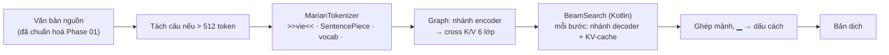

# DR-07 — Engine dịch và gói MT trên app

**Trạng thái:** đã chốt; bổ sung mục 12 (chính sách giải mã), mục 13 (4-bit khối 16), mục 14 (lớp đầu ra 4+4 bit) · **Ngày:** 2026-10-07 · **Người viết:** Đạt ·
**Liên quan:** Phase 04 (phía app), [mt_package_v2.md](../contracts/mt_package_v2.md),
Core `evidence/phase03/main_core_decision.json` (commit `50fb865`), `tools/mt/`, `app/.../mt/marian/`

## 1. Bối cảnh & ràng buộc

Core Phase 03 freeze Student MarianMT làm Main-Core cho EN→VI và VI→EN; README Phase 04 của Core
giao việc convert, lượng tử hoá và đo cho phía app. Ràng buộc: dịch offline, model nằm sẵn trong
APK; máy khoảng 4 GB RAM, ABI arm64-v8a và x86_64; bản dịch trên máy phải so được với checkpoint
(cùng tiền tố, tokenizer, cách giải mã như lúc Core đánh giá); người dùng muốn app nhẹ và phản hồi nhanh.

## 2. Định nghĩa

- **Main-Core**: checkpoint Student đã freeze, mỗi chiều một model MarianMT (6 lớp encoder, 6 lớp
  decoder, d_model 512, 71,7 triệu tham số, 276 MB fp32).
- **Beam search**: giữ nhiều câu đang dịch song song, mỗi bước chọn các nối dài có tổng log-xác suất
  cao nhất. `generation_config` của checkpoint đặt 4 beam (EN→VI) và 6 beam (VI→EN).
- **KV-cache**: lưu key/value của các bước decoder trước để mỗi bước chỉ tính token mới.
- **Lượng tử hoá theo khối (MatMulNBits)**: trọng số lưu 8 bit, mỗi khối 32 số có scale và zero point
  riêng; `accuracy_level` 4 lượng tử hoá activation theo khối lúc tính để dùng kernel int8.

## 3. Quy trình hoạt động

Chạy trên luồng `mt` (một luồng cho nạp, dịch, giải phóng), ONNX Runtime 2 luồng tính, không spin.

## 4. Ứng viên

| Ứng viên | Dung lượng/chiều | Khớp HF (30 câu) | 1 bước 4 beam (PC) | Ghi chú (nguồn) |
|---|---|---|---|---|
| Optimum export (encoder + decoder + decoder_with_past) + `quantize_dynamic` int8 | ~127 MB (embedding 3 bản) | — | — | Ước tính từ số tham số; activation per-tensor như dòng dưới |
| Graph tự dựng, int8 động (DynamicQuantizeMatMul) | 74 MB | 7/30, có lặp từ | — | đo 2026-10-07 [1] |
| Graph tự dựng, 4-bit block 32 | 54 MB | 5/30 | 25 ms | [1] |
| Graph tự dựng, 4-bit lớp + 8-bit embedding | 69 MB | 6/30 | — | [1] |
| Graph tự dựng, 8-bit block 32, activation fp32 | 91 MB | 28/30 | 250 ms | ORT 1.30 chưa có kernel nhanh [1] |
| **Graph tự dựng, 8-bit block 32, accuracy level 4** | **91 MB** | **20/30 (EN→VI), 23/30 (VI→EN)** | **10 ms** | [1], [2] |
| CTranslate2 / Marian C++ | — | — | — | Không có bản Android dựng sẵn, phải tự build NDK |

## 5. Tiêu chí

Giữ chất lượng của Student Phase 03 (chrF++, BLEU trên đúng các tập Core dùng); dung lượng APK; tốc độ
một bước decoder; chạy được bằng thư viện Android có sẵn; tái lập được từ checkpoint và hash.

## 6. Ứng viên được chọn

Graph ONNX tự dựng (`tools/mt/build_marian_onnx.py`), 8-bit `MatMulNBits` block 32, accuracy level 4;
chạy bằng `com.microsoft.onnxruntime:onnxruntime-android:1.30.0`; tokenizer và beam search viết bằng Kotlin.

## 7. Lý do chọn & thiết kế tích hợp

- **Chất lượng**: trên toàn bộ các tập Phase 03 dùng, chrF++ lệch tối đa 0,04 điểm so với Student
  (EN→VI 66,54/66,55 IT Val., 52,46/52,44 General Val.; VI→EN 61,26/61,30 và 46,21/46,20) [2].
- **Dung lượng**: một file/chiều, embedding dùng chung cho đầu vào encoder, đầu vào decoder và LM head
  (lưu 1 lần thay vì 3); 91 MB/chiều thay vì 276 MB.
- **Tốc độ**: 10 ms/bước trên PC, nhanh hơn fp32 (22 ms); trên AVD một câu ngắn 0,6–1,1 s.
- **Đúng với checkpoint**: graph fp32 khớp HF 30/30 câu; beam search port từng bước của transformers 4.57,
  giữ `num_beams` theo từng chiều; tokenizer khớp HF 100% trên 4 873 câu/chiều.
- **Tích hợp**: `MtPackageManifest` v2 + `MtPackageValidator` (từ chối gói mà decoder không hỗ trợ),
  `CoreMtProvider` → `MarianTranslator` → `MarianEngine`; nạp theo màn bằng
  `TranslatorRegistry.retainOnly`, giải phóng ở `onTrimMemory`. Gói dựng bằng `tools/mt/package_mt.py`,
  không commit (như model giọng nói).

## 8. Ưu điểm

- Không cần NDK hay thư viện native tự build; chỉ thêm một AAR chính thức.
- Kiểm soát hoàn toàn graph: KV-cache, sắp lại beam trong graph, không phụ thuộc phiên bản Optimum.
- Mọi bước có test so với Hugging Face (tokenizer, golden, beam search).

## 9. Nhược điểm & rủi ro

- **Dung lượng APK** tăng khoảng 190 MB (2 model nén 170 MB + ONNX Runtime 33–39 MB/ABI): APK offline
  arm64 298 MB. Giảm được nếu tự build ONNX Runtime chỉ với các toán tử cần (minimal build) hoặc dùng
  chung ORT với sherpa-onnx bản không link tĩnh; chưa làm.
- **Kernel int8 khác giữa ARM và x86**: bản dịch trên điện thoại có thể khác vài từ so với PC ở số ít
  câu. Phát hiện bằng `golden.jsonl` trên máy thật (Phase 05).
- **RAM**: màn Hội thoại giữ 2 model dịch + 4 model giọng nói (AVD: 657 MB PSS). Giải phóng khi vào nền.
- **Nạp model**: đọc 91 MB vào heap Java một lần (bật `largeHeap`); lần dịch đầu tiên chậm hơn nếu
  chưa kịp nạp trước (AVD: 2,3 s gồm nạp).
- **Giấy phép**: Student chưng cất từ EnViT5 (OpenRAIL) nên mang giới hạn sử dụng của OpenRAIL.

## 10. Kiểm chứng

- `python -I tools/mt/marian_ref.py verify` — fp32 30/30, q8 xem mục 4.
- `python -I tools/mt/marian_ref.py eval` ×4 + `record_eval.py` → `APP_MT_EXPORT_QUALITY=RECORDED`,
  `evidence/phase04/mt_export_q8/run.json`.
- `python -I tools/mt/package_mt.py --quality evidence/phase04/mt_export_q8` → `APP_MT_PACKAGE=PASS`.
- `gradlew test`: 57 test/flavor xanh, gồm `MarianTokenizerParityTest`, `MarianGoldenTest`, `BeamSearchTest`.
- AVD Pixel_10a (x86_64, 2 GB), chế độ máy bay: EN→VI và VI→EN dịch và đọc được, không văng app.
  Emulator chỉ kiểm tra chức năng; tốc độ trên điện thoại đo ở Phase 05.

## 11. Nguồn

1. Đo ngày 2026-10-07 bằng `tools/mt/marian_ref.py verify` và đo thời gian bước decoder (i5-12500H, ORT 1.30.0, 2 luồng).
2. `evidence/phase04/mt_export_q8/run.json` và `*.summary.json`.
3. Core `evidence/phase03/main_core_decision.json`; `models/phase03/*/final-epoch-1/generation_config.json`.

## 12. Bổ sung 2026-10-07: chính sách giải mã của app (sau khi thử trên điện thoại)

**Hiện tượng (điện thoại thật, gõ chữ, VI→EN):** "chao ban" → "Order" (55 ms); "chào bạn" → "Hello" nhưng
MT 12 748 ms; "xin chao" → "Please, please, …" (940 ms).

**Áp dụng sai hay model sai?** Chạy cùng câu trên checkpoint PyTorch `phase03-seqkd-vi-to-en-v3` với
`generation_config` của nó: ra **đúng từng token** như app ("chào bạn" → "Hello" mất 28,8 s trên PC,
ONNX 19,4 s). Vậy app áp dụng đúng; hai hiện tượng đến từ model và cấu hình sinh câu:

- **Dịch sai:** tiếng Việt **không dấu** nằm ngoài dữ liệu học ("cam on ban" → "cam on board", "toi muon
  di ga tau" → "Implemente move the route"); có dấu thì đúng ("tôi muốn đi ga tàu" → "I want to go to the
  train station"). STT luôn viết có dấu, nên chỉ gặp khi gõ.
- **Chậm:** `num_beams=6`, `early_stopping=false`, `max_length=512`. Beam tốt nhất xong "Hello" ở bước 2,
  nhưng heuristic dừng cần đủ 6 giả thuyết hoàn chỉnh; các beam còn lại không gặp EOS nên chạy tới
  511 bước (khoảng 25 ms/bước × 6 beam trên điện thoại). Trong 22 câu hội thoại ngắn mỗi chiều: EN→VI
  không câu nào; VI→EN "chào bạn" 511 bước, "vâng" 302, "không" → "No, no, no…" 104.

**Quyết định (phía app, không đổi model và manifest):**

| Chính sách | Code | Lý do |
|---|---|---|
| `max_length` = min(512, 2 × id nguồn + 20) | `GenerationParams.maxLengthFor`, `marian_ref.app_max_length` | Chặn tìm kiếm vô ích; trên Validation chỉ 7/32 498 đầu ra dài hơn, đều là lặp |
| Tới ngưỡng: trả giả thuyết hoàn chỉnh tốt nhất nếu có, chưa có mới ép EOS | `BeamSearch(preferFinished = true)`, `beam_search(prefer_finished=True)` | Ép EOS kiểu HF ở ngưỡng làm 4 câu bình thường tệ đi (vd. "…Written by Jamie Zawinski; 1999." → "…http: //en. wikipedia…") vì beam lặp dài thắng nhờ điểm trung bình. Quy tắc này giữ nguyên mọi đầu ra ngắn hơn ngưỡng |
| Gộp cụm 1–3 từ lặp ≥ 4 lần liên tiếp | `OutputCleanup.collapseRepeats`, `marian_ref.collapse_repeats` | "Please, please, …" → "Please"; câu tham chiếu chỉ 2/32 498 có lặp thật |
| Cảnh báo khi gõ tiếng Việt không dấu (vẫn dịch) | `text/VietnameseDiacritics` | Không thể sửa trong app nếu không thêm model khôi phục dấu |

**Kết quả trên 4 tập Validation** (`evidence/phase04/mt_length_cap/run.json`, cùng graph q8, so với
`mt_export_q8` không giới hạn):

| Tập | Câu | Đổi do giới hạn | Bản không giới hạn dài hơn ngưỡng | Đổi sau gộp lặp | chrF++ không giới hạn → app | Bước giải mã TB / p95 / max |
|---|---|---|---|---|---|---|
| EN→VI Selection | 15 252 | 2 | 2 | 11 | 66,536 → 66,563 | 18,7 / 33 / 334 |
| EN→VI General | 997 | 0 | 0 | 2 | 52,455 → 52,457 | 33,6 / 54 / 84 |
| VI→EN Selection | 15 252 | 5 | 5 | 14 | 61,258 → 61,352 | 15,9 / 29 / 462 |
| VI→EN General | 997 | 0 | 0 | 0 | 46,211 → 46,211 | 27,5 / 44 / 74 |

Số câu đổi do giới hạn đúng bằng số câu mà bản không giới hạn dài hơn ngưỡng: 7 câu lặp 239–511 token
("g- g- g-…", "wiki/ wiki/…", "yyyy…"), nay 15–71 token; một câu thành câu đúng. sacreBLEU EN→VI General
giảm 0,002 do gộp lặp, các tập khác tăng hoặc giữ nguyên.

**Câu ngắn sau khi sửa** (Kotlin = Python, `MarianGoldenTest.shortInputStopsAtTheLengthCap`): "chào bạn" →
"Hello" 24 bước; "vâng" → "Yes" 22; "không" → "none" 22; "xin chao" → "Please".

**Còn lại cho Core** (ghi ở `design_check.md` mục 7.9): Student kém với câu một hai từ và tiếng Việt không
dấu; đề xuất thêm dữ liệu kiểu này khi train và đưa vài câu ngắn vào bộ đánh giá.

**Kiểm chứng:** `marian_ref.py eval --length-cap` ×4 + `record_app_policy.py` → `APP_MT_POLICY=RECORDED`;
`gradlew :app:testDebugUnitTest` 67/67 (`BeamSearchTest.preferFinishedKeepsTheCompleteSentenceAtTheCap`,
`OutputCleanupTest` parity với Python trên 33 ca, `MarianGoldenTest`); bản release trên AVD: "xin chao" →
"Please" kèm cảnh báo.

## 13. Bổ sung 2026-10-08: chuyển sang 4-bit khối 16 (máy không có dotprod dịch 15–30 s)

**Hiện tượng (điện thoại thật):** STT khoảng 100 ms, TTS 1–2 s, **MT 15–30 s** mỗi câu; trên AVD x86_64
cùng APK chỉ khoảng 140 ms.

**Nguyên nhân (đọc mã ONNX Runtime 1.30, `qnbitgemm_kernel_neon.cpp` và `matmul_nbits.cc`):**

- Trên ARM64, kernel nhanh cho `MatMulNBits` **8-bit** (`SQ8BitGemmKernel_BlkSum_CompInt8`) chỉ được bật khi
  CPU có lệnh **dotprod** hoặc **i8mm** (ARMv8.2+: Cortex-A55/A75/A76…). 8-bit không có kernel `CompFp32`.
- Thiếu kernel thì `MatMulNBits` chạy `ComputeBUnpacked`: cấp phát và **giải nén cả ma trận trọng số sang
  float ở mỗi lần gọi**, rồi SGEMM. Mỗi bước giải mã gọi decoder (25,2 triệu tham số) và lớp đầu ra
  (53 684 × 512 = 27,5 triệu, riêng nó 110 MB float) → mỗi bước ghi hơn 200 MB.
- Trọng số **4-bit** có kernel `CompFp32` cho **mọi** CPU ARM64 (NEON) và `CompInt8` khi có dotprod.
- Đo trên PC (2 luồng, 6 beam; `accuracy_level 0` buộc đường không dùng kernel int8, tức như máy không có
  dotprod):

| Bản | Có kernel int8 | Không có kernel int8 |
|---|---|---|
| 8-bit khối 32 (cũ) | 15,6 ms/bước | **232 ms/bước** |
| 4-bit khối 32 | 19,6 ms/bước | 29,6 ms/bước |
| **4-bit khối 16** | 21,3 ms/bước | **22,9 ms/bước** |

232 ms × 30–60 bước ≈ 7–14 s trên PC, nên 15–30 s trên điện thoại yếu là khớp.

**Ứng viên** (`build_marian_onnx.py --block`, `--clip`: chọn ngưỡng cắt từng khối cho sai số bình phương nhỏ
nhất; chrF++ theo chính sách giải mã của app, không gộp lặp; General = toàn bộ 997 câu, Selection = 1/8):

| Bản | Dung lượng/chiều | EN→VI General | EN→VI Sel. 1/8 | VI→EN General | VI→EN Sel. 1/8 |
|---|---|---|---|---|---|
| 8-bit khối 32 (cũ) | 91 MB | 52,46 | 66,67 | 46,21 | 60,97 |
| 4-bit khối 32 | 54 MB | 52,20 | 66,40 | 45,97 | 60,66 |
| 4-bit khối 32 + clip | 54 MB | 52,21 | 66,41 | 45,93 | 60,92 |
| **4-bit khối 16 + clip** | **71 MB** | **52,40** | **66,73** | **46,08** | **60,84** |

**Quyết định (thay bằng §14 cùng ngày):** gói `vtt-main-core-phase03-q4b16c` (`package_mt.py --variant q4b16c`), `accuracy_level` 4 (int8
khi CPU có dotprod, float khi không). Đánh giá đầy đủ (`evidence/phase04/mt_export_q4b16c/`, 32 498 câu):

| Tập | Student Phase 03 | 8-bit (app) | 4-bit khối 16 | Chênh so với 8-bit |
|---|---|---|---|---|
| EN→VI Selection | 66,55 | 66,56 | 66,30 | −0,26 |
| EN→VI General | 52,44 | 52,46 | 52,40 | −0,06 |
| VI→EN Selection | 61,30 | 61,35 | 61,01 | −0,34 |
| VI→EN General | 46,20 | 46,21 | 46,08 | −0,13 |

- Đổi lại: máy không có dotprod nhanh khoảng 10 lần mỗi bước; máy có kernel int8 không chậm đi (AVD:
  8,9 / 11,3 ms/bước so với 9,1 / 11,2); APK arm64 302,6 → 254,3 MB; RAM app 687 → 666 MB.
- Mất 0,06–0,34 chrF++ (tối đa 0,5 %), nhiều nhất ở tập IT.

**Còn có thể làm** (chưa làm, cần đo):

| Hướng | Ước tính | Rủi ro chất lượng |
|---|---|---|
| Cắt lớp đầu ra còn các token phía đích (chỉ 32 % / 40 % từ vựng xuất hiện ở câu đích: 121 nghìn câu train + đầu ra Validation) | Bớt khoảng 30 % phép tính mỗi bước | Gần như không; kiểm bằng khớp từng câu |
| Lượng tử hoá theo hoạt hoá (AWQ, cần câu hiệu chỉnh) | Không đổi tốc độ | Có thể lấy lại phần 0,1–0,3 chrF++ đã mất |
| Ít beam hơn trên máy yếu | Bớt phép tính theo số beam | Phải đo trên Validation |

**Kiểm chứng:** `marian_ref.py eval --length-cap` ×4 + `record_eval.py --policy app` → `APP_MT_EXPORT_QUALITY=RECORDED`;
`package_mt.py --variant q4b16c --quality evidence/phase04/mt_export_q4b16c` → `APP_MT_PACKAGE=PASS` (graph trùng byte với
bản đã đánh giá); `gradlew :app:testDebugUnitTest` 67/67 (Kotlin = Python trên golden và câu ngắn); AVD: "Kiểm tra máy này"
20/20 câu mỗi chiều khớp bản mẫu PC.

## 14. Bổ sung 2026-10-08: lớp đầu ra 4+4 bit (ưu tiên chất lượng)

Người dùng chốt: chất lượng là ưu tiên, tốc độ chỉ cần "không quá lâu". Bản §13 mất 0,06–0,34 chrF++ so với 8-bit.
Thử để tìm phần gây mất (chrF++ theo chính sách của app; General = toàn bộ, IT = 1/8 Selection):

| Bản | MB/chiều | EN→VI General | EN→VI IT | VI→EN General | VI→EN IT | Tổng chênh với 8-bit | Chạy nhanh trên ARM không dotprod |
|---|---|---|---|---|---|---|---|
| 8-bit | 91 | 52,46 | 66,67 | 46,21 | 60,97 | 0 | không |
| 4-bit khối 16 (§13) | 71 | 52,40 | 66,73 | 46,08 | 60,84 | −0,26 | có |
| + GPTQ lớp Linear (`tools/mt/gptq_marian.py`, 256 câu IT) | 71 | 52,38 | 66,74 | 45,81 | 60,99 | −0,39 | có |
| + GPTQ cả lớp đầu ra | 71 | 52,29 | 66,55 | 45,82 | 61,05 | −0,60 | có |
| GPTQ damping 0,1 | 71 | 52,28 | 66,74 | 45,88 | 60,86 | −0,44 | có |
| Linear 4-bit, embedding + đầu ra 8-bit (`q4e8`) | 86 | 52,31 | 66,76 | 46,22 | 61,09 | +0,07 | không (đầu ra 8-bit) |
| Linear 4-bit, chỉ bảng tra embedding 8-bit (`q4g8`) | 87 | 52,49 | 66,71 | 45,98 | 60,93 | −0,20 | có |
| **Linear 4-bit, đầu ra 4+4 bit (`q4r`)** | **82,5** | 52,38 | 66,66 | 46,10 | 61,01 | **−0,16** | **có** |

- GPTQ không giúp: dữ liệu hiệu chỉnh chỉ có miền IT (Core không có dữ liệu train miền chung), VI→EN General giảm.
- Phần mất nằm ở **lớp đầu ra** (ma trận dùng chung 53 684 × 512): đưa nó lên 8-bit thì ngang 8-bit (`q4e8`), còn
  bảng tra embedding 8-bit hầu như không đổi gì (`q4g8`). Nhưng đầu ra 8-bit lại chạy đường chậm trên ARM không có dotprod.
- **Giải pháp `q4r`:** lưu lớp đầu ra thành hai tensor 4-bit, tầng 2 lượng tử hoá phần dư của tầng 1 (W ≈ Q1 + Q2), tính bằng
  hai `MatMulNBits` 4-bit rồi cộng. Độ chính xác gần 8-bit (tỉ lệ câu giống hệt 8-bit: 41/74/30/73 % như `q4e8`), chỉ cần kernel
  4-bit. Bảng tra embedding dùng Q1 + Q2, lấy scale từ chính tensor của `MatMulNBits` (không lưu bản sao), zero point uint8.

**Đánh giá đầy đủ** (`evidence/phase04/mt_export_q4r/`, 32 498 câu; gói đóng trùng mã băm với bản đánh giá; bản bảng tra
gọn cho kết quả giống hệt bản đã thử trên toàn bộ General):

| Tập | Student | 8-bit | 4-bit §13 | **q4r** | Chênh với 8-bit |
|---|---|---|---|---|---|
| EN→VI IT Selection | 66,55 | 66,56 | 66,30 | **66,42** | −0,14 |
| EN→VI General | 52,44 | 52,46 | 52,40 | **52,38** | −0,08 |
| VI→EN IT Selection | 61,30 | 61,35 | 61,01 | **61,31** | −0,04 |
| VI→EN General | 46,20 | 46,21 | 46,08 | **46,10** | −0,11 |

**Giá phải trả** (so với 4-bit §13):

| | 4-bit §13 | q4r |
|---|---|---|
| Mô hình/chiều | 71,4 MB | 82,5 MB |
| APK arm64 | 254,3 MB | 281,8 MB (8-bit: 302,6 MB) |
| AVD ms/bước (2 luồng) EN→VI / VI→EN | 8,9 / 11,3 | 10,5 / 16,7 |
| PC, không kernel int8, 6 beam | ~45 ms/bước | ~55 ms/bước (8-bit: ~240) |
| RAM app khi đủ 6 mô hình (AVD) | 666 MB | 797 MB (ONNX Runtime đóng gói sẵn trọng số cả hai tầng) |

**Quyết định:** gói `vtt-main-core-phase03-q4r` (`package_mt.py --variant q4r`, mặc định). Nếu máy 3 GB bị đóng app vì RAM,
có thể cho bảng tra embedding chỉ dùng Q1 (bớt bảng phụ) hoặc quay về §13; cả hai cần đo lại.

**Kiểm chứng:** `marian_ref.py eval --length-cap` + `record_eval.py --policy app` → `APP_MT_EXPORT_QUALITY=RECORDED`;
`package_mt.py --variant q4r --quality evidence/phase04/mt_export_q4r` → `APP_MT_PACKAGE=PASS`; `gradlew :app:testDebugUnitTest`
67/67 (Kotlin = Python từng token, gồm hai `MatMulNBits` của lớp đầu ra); AVD: "Kiểm tra máy này" 20/20 câu mỗi chiều khớp PC.
