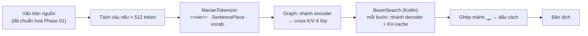

# DR-07 — Engine dịch và gói MT trên app

**Trạng thái:** đã chốt; bổ sung mục 12 (chính sách giải mã), mục 13 (4-bit khối 16), mục 14 (lớp đầu ra 4+4 bit) · **Ngày:** 2026-10-07 · **Người viết:** Đạt ·
**Liên quan:** Phase 04 (phía app), [mt_package_v2.md](../contracts/mt_package_v2.md),
Core `evidence/phase03/main_core_decision.json` (commit `50fb865`), `tools/mt/`, `app/.../mt/marian/`

## 1. Bối cảnh & ràng buộc

Core Phase 03 freeze Student MarianMT làm Main-Core cho EN→VI và VI→EN; README Phase 04 của Core
giao việc convert, lượng tử hoá và đo cho phía app. Ràng buộc: dịch offline, model nằm sẵn trong
APK; máy khoảng 4 GB RAM, ABI arm64-v8a và x86_64; bản dịch trên máy phải so được với checkpoint
(cùng tiền tố, tokenizer, cách giải mã như lúc Core đánh giá); người dùng muốn app nhẹ và phản hồi nhanh.

## 2. Định nghĩa

- **Main-Core**: checkpoint Student đã freeze, mỗi chiều một model MarianMT (6 lớp encoder, 6 lớp
  decoder, d_model 512, 71,7 triệu tham số, 276 MB fp32).
- **Beam search**: giữ nhiều câu đang dịch song song, mỗi bước chọn các nối dài có tổng log-xác suất
  cao nhất. `generation_config` của checkpoint đặt 4 beam (EN→VI) và 6 beam (VI→EN).
- **KV-cache**: lưu key/value của các bước decoder trước để mỗi bước chỉ tính token mới.
- **Lượng tử hoá theo khối (MatMulNBits)**: trọng số lưu 8 bit, mỗi khối 32 số có scale và zero point
  riêng; `accuracy_level` 4 lượng tử hoá activation theo khối lúc tính để dùng kernel int8.

## 3. Quy trình hoạt động

Chạy trên luồng `mt` (một luồng cho nạp, dịch, giải phóng), ONNX Runtime 2 luồng tính, không spin.

## 4. Ứng viên

| Ứng viên | Dung lượng/chiều | Khớp HF (30 câu) | 1 bước 4 beam (PC) | Ghi chú (nguồn) |
|---|---|---|---|---|
| Optimum export (encoder + decoder + decoder_with_past) + `quantize_dynamic` int8 | ~127 MB (embedding 3 bản) | — | — | Ước tính từ số tham số; activation per-tensor như dòng dưới |
| Graph tự dựng, int8 động (DynamicQuantizeMatMul) | 74 MB | 7/30, có lặp từ | — | đo 2026-10-07 [1] |
| Graph tự dựng, 4-bit block 32 | 54 MB | 5/30 | 25 ms | [1] |
| Graph tự dựng, 4-bit lớp + 8-bit embedding | 69 MB | 6/30 | — | [1] |
| Graph tự dựng, 8-bit block 32, activation fp32 | 91 MB | 28/30 | 250 ms | ORT 1.30 chưa có kernel nhanh [1] |
| **Graph tự dựng, 8-bit block 32, accuracy level 4** | **91 MB** | **20/30 (EN→VI), 23/30 (VI→EN)** | **10 ms** | [1], [2] |
| CTranslate2 / Marian C++ | — | — | — | Không có bản Android dựng sẵn, phải tự build NDK |

## 5. Tiêu chí

Giữ chất lượng của Student Phase 03 (chrF++, BLEU trên đúng các tập Core dùng); dung lượng APK; tốc độ
một bước decoder; chạy được bằng thư viện Android có sẵn; tái lập được từ checkpoint và hash.

## 6. Ứng viên được chọn

Graph ONNX tự dựng (`tools/mt/build_marian_onnx.py`), 8-bit `MatMulNBits` block 32, accuracy level 4;
chạy bằng `com.microsoft.onnxruntime:onnxruntime-android:1.30.0`; tokenizer và beam search viết bằng Kotlin.

## 7. Lý do chọn & thiết kế tích hợp

- **Chất lượng**: trên toàn bộ các tập Phase 03 dùng, chrF++ lệch tối đa 0,04 điểm so với Student
  (EN→VI 66,54/66,55 IT Val., 52,46/52,44 General Val.; VI→EN 61,26/61,30 và 46,21/46,20) [2].
- **Dung lượng**: một file/chiều, embedding dùng chung cho đầu vào encoder, đầu vào decoder và LM head
  (lưu 1 lần thay vì 3); 91 MB/chiều thay vì 276 MB.
- **Tốc độ**: 10 ms/bước trên PC, nhanh hơn fp32 (22 ms); trên AVD một câu ngắn 0,6–1,1 s.
- **Đúng với checkpoint**: graph fp32 khớp HF 30/30 câu; beam search port từng bước của transformers 4.57,
  giữ `num_beams` theo từng chiều; tokenizer khớp HF 100% trên 4 873 câu/chiều.
- **Tích hợp**: `MtPackageManifest` v2 + `MtPackageValidator` (từ chối gói mà decoder không hỗ trợ),
  `CoreMtProvider` → `MarianTranslator` → `MarianEngine`; nạp theo màn bằng
  `TranslatorRegistry.retainOnly`, giải phóng ở `onTrimMemory`. Gói dựng bằng `tools/mt/package_mt.py`,
  không commit (như model giọng nói).

## 8. Ưu điểm

- Không cần NDK hay thư viện native tự build; chỉ thêm một AAR chính thức.
- Kiểm soát hoàn toàn graph: KV-cache, sắp lại beam trong graph, không phụ thuộc phiên bản Optimum.
- Mọi bước có test so với Hugging Face (tokenizer, golden, beam search).

## 9. Nhược điểm & rủi ro

- **Dung lượng APK** tăng khoảng 190 MB (2 model nén 170 MB + ONNX Runtime 33–39 MB/ABI): APK offline
  arm64 298 MB. Giảm được nếu tự build ONNX Runtime chỉ với các toán tử cần (minimal build) hoặc dùng
  chung ORT với sherpa-onnx bản không link tĩnh; chưa làm.
- **Kernel int8 khác giữa ARM và x86**: bản dịch trên điện thoại có thể khác vài từ so với PC ở số ít
  câu. Phát hiện bằng `golden.jsonl` trên máy thật (Phase 05).
- **RAM**: màn Hội thoại giữ 2 model dịch + 4 model giọng nói (AVD: 657 MB PSS). Giải phóng khi vào nền.
- **Nạp model**: đọc 91 MB vào heap Java một lần (bật `largeHeap`); lần dịch đầu tiên chậm hơn nếu
  chưa kịp nạp trước (AVD: 2,3 s gồm nạp).
- **Giấy phép**: Student chưng cất từ EnViT5 (OpenRAIL) nên mang giới hạn sử dụng của OpenRAIL.

## 10. Kiểm chứng

- `python -I tools/mt/marian_ref.py verify` — fp32 30/30, q8 xem mục 4.
- `python -I tools/mt/marian_ref.py eval` ×4 + `record_eval.py` → `APP_MT_EXPORT_QUALITY=RECORDED`,
  `evidence/phase04/mt_export_q8/run.json`.
- `python -I tools/mt/package_mt.py --quality evidence/phase04/mt_export_q8` → `APP_MT_PACKAGE=PASS`.
- `gradlew test`: 57 test/flavor xanh, gồm `MarianTokenizerParityTest`, `MarianGoldenTest`, `BeamSearchTest`.
- AVD Pixel_10a (x86_64, 2 GB), chế độ máy bay: EN→VI và VI→EN dịch và đọc được, không văng app.
  Emulator chỉ kiểm tra chức năng; tốc độ trên điện thoại đo ở Phase 05.

## 11. Nguồn

1. Đo ngày 2026-10-07 bằng `tools/mt/marian_ref.py verify` và đo thời gian bước decoder (i5-12500H, ORT 1.30.0, 2 luồng).
2. `evidence/phase04/mt_export_q8/run.json` và `*.summary.json`.
3. Core `evidence/phase03/main_core_decision.json`; `models/phase03/*/final-epoch-1/generation_config.json`.

## 12. Bổ sung 2026-10-07: chính sách giải mã của app (sau khi thử trên điện thoại)

**Hiện tượng (điện thoại thật, gõ chữ, VI→EN):** "chao ban" → "Order" (55 ms); "chào bạn" → "Hello" nhưng
MT 12 748 ms; "xin chao" → "Please, please, …" (940 ms).

**Áp dụng sai hay model sai?** Chạy cùng câu trên checkpoint PyTorch `phase03-seqkd-vi-to-en-v3` với
`generation_config` của nó: ra **đúng từng token** như app ("chào bạn" → "Hello" mất 28,8 s trên PC,
ONNX 19,4 s). Vậy app áp dụng đúng; hai hiện tượng đến từ model và cấu hình sinh câu:

- **Dịch sai:** tiếng Việt **không dấu** nằm ngoài dữ liệu học ("cam on ban" → "cam on board", "toi muon
  di ga tau" → "Implemente move the route"); có dấu thì đúng ("tôi muốn đi ga tàu" → "I want to go to the
  train station"). STT luôn viết có dấu, nên chỉ gặp khi gõ.
- **Chậm:** `num_beams=6`, `early_stopping=false`, `max_length=512`. Beam tốt nhất xong "Hello" ở bước 2,
  nhưng heuristic dừng cần đủ 6 giả thuyết hoàn chỉnh; các beam còn lại không gặp EOS nên chạy tới
  511 bước (khoảng 25 ms/bước × 6 beam trên điện thoại). Trong 22 câu hội thoại ngắn mỗi chiều: EN→VI
  không câu nào; VI→EN "chào bạn" 511 bước, "vâng" 302, "không" → "No, no, no…" 104.

**Quyết định (phía app, không đổi model và manifest):**

| Chính sách | Code | Lý do |
|---|---|---|
| `max_length` = min(512, 2 × id nguồn + 20) | `GenerationParams.maxLengthFor`, `marian_ref.app_max_length` | Chặn tìm kiếm vô ích; trên Validation chỉ 7/32 498 đầu ra dài hơn, đều là lặp |
| Tới ngưỡng: trả giả thuyết hoàn chỉnh tốt nhất nếu có, chưa có mới ép EOS | `BeamSearch(preferFinished = true)`, `beam_search(prefer_finished=True)` | Ép EOS kiểu HF ở ngưỡng làm 4 câu bình thường tệ đi (vd. "…Written by Jamie Zawinski; 1999." → "…http: //en. wikipedia…") vì beam lặp dài thắng nhờ điểm trung bình. Quy tắc này giữ nguyên mọi đầu ra ngắn hơn ngưỡng |
| Gộp cụm 1–3 từ lặp ≥ 4 lần liên tiếp | `OutputCleanup.collapseRepeats`, `marian_ref.collapse_repeats` | "Please, please, …" → "Please"; câu tham chiếu chỉ 2/32 498 có lặp thật |
| Cảnh báo khi gõ tiếng Việt không dấu (vẫn dịch) | `text/VietnameseDiacritics`; từ 2026-10-23 là R07 trong `mt/rules/LanguageGuesser` (§16) | Không thể sửa trong app nếu không thêm model khôi phục dấu |

**Kết quả trên 4 tập Validation** (`evidence/phase04/mt_length_cap/run.json`, cùng graph q8, so với
`mt_export_q8` không giới hạn):

| Tập | Câu | Đổi do giới hạn | Bản không giới hạn dài hơn ngưỡng | Đổi sau gộp lặp | chrF++ không giới hạn → app | Bước giải mã TB / p95 / max |
|---|---|---|---|---|---|---|
| EN→VI Selection | 15 252 | 2 | 2 | 11 | 66,536 → 66,563 | 18,7 / 33 / 334 |
| EN→VI General | 997 | 0 | 0 | 2 | 52,455 → 52,457 | 33,6 / 54 / 84 |
| VI→EN Selection | 15 252 | 5 | 5 | 14 | 61,258 → 61,352 | 15,9 / 29 / 462 |
| VI→EN General | 997 | 0 | 0 | 0 | 46,211 → 46,211 | 27,5 / 44 / 74 |

Số câu đổi do giới hạn đúng bằng số câu mà bản không giới hạn dài hơn ngưỡng: 7 câu lặp 239–511 token
("g- g- g-…", "wiki/ wiki/…", "yyyy…"), nay 15–71 token; một câu thành câu đúng. sacreBLEU EN→VI General
giảm 0,002 do gộp lặp, các tập khác tăng hoặc giữ nguyên.

**Câu ngắn sau khi sửa** (Kotlin = Python, `MarianGoldenTest.shortInputStopsAtTheLengthCap`): "chào bạn" →
"Hello" 24 bước; "vâng" → "Yes" 22; "không" → "none" 22; "xin chao" → "Please".

**Còn lại cho Core** (ghi ở `design_check.md` mục 7.9): Student kém với câu một hai từ và tiếng Việt không
dấu; đề xuất thêm dữ liệu kiểu này khi train và đưa vài câu ngắn vào bộ đánh giá.

**Kiểm chứng:** `marian_ref.py eval --length-cap` ×4 + `record_app_policy.py` → `APP_MT_POLICY=RECORDED`;
`gradlew :app:testDebugUnitTest` 67/67 (`BeamSearchTest.preferFinishedKeepsTheCompleteSentenceAtTheCap`,
`OutputCleanupTest` parity với Python trên 33 ca, `MarianGoldenTest`); bản release trên AVD: "xin chao" →
"Please" kèm cảnh báo.

## 13. Bổ sung 2026-10-08: chuyển sang 4-bit khối 16 (máy không có dotprod dịch 15–30 s)

**Hiện tượng (điện thoại thật):** STT khoảng 100 ms, TTS 1–2 s, **MT 15–30 s** mỗi câu; trên AVD x86_64
cùng APK chỉ khoảng 140 ms.

**Nguyên nhân (đọc mã ONNX Runtime 1.30, `qnbitgemm_kernel_neon.cpp` và `matmul_nbits.cc`):**

- Trên ARM64, kernel nhanh cho `MatMulNBits` **8-bit** (`SQ8BitGemmKernel_BlkSum_CompInt8`) chỉ được bật khi
  CPU có lệnh **dotprod** hoặc **i8mm** (ARMv8.2+: Cortex-A55/A75/A76…). 8-bit không có kernel `CompFp32`.
- Thiếu kernel thì `MatMulNBits` chạy `ComputeBUnpacked`: cấp phát và **giải nén cả ma trận trọng số sang
  float ở mỗi lần gọi**, rồi SGEMM. Mỗi bước giải mã gọi decoder (25,2 triệu tham số) và lớp đầu ra
  (53 685 × 512 ở Anh→Việt, 53 739 × 512 ở Việt→Anh: khoảng 27,5 triệu số, riêng nó 110 MB float) → mỗi bước ghi hơn 200 MB.
- Trọng số **4-bit** có kernel `CompFp32` cho **mọi** CPU ARM64 (NEON) và `CompInt8` khi có dotprod.
- Đo trên PC (2 luồng, 6 beam; `accuracy_level 0` buộc đường không dùng kernel int8, tức như máy không có
  dotprod):

| Bản | Có kernel int8 | Không có kernel int8 |
|---|---|---|
| 8-bit khối 32 (cũ) | 15,6 ms/bước | **232 ms/bước** |
| 4-bit khối 32 | 19,6 ms/bước | 29,6 ms/bước |
| **4-bit khối 16** | 21,3 ms/bước | **22,9 ms/bước** |

232 ms × 30–60 bước ≈ 7–14 s trên PC, nên 15–30 s trên điện thoại yếu là khớp.

**Ứng viên** (`build_marian_onnx.py --block`, `--clip`: chọn ngưỡng cắt từng khối cho sai số bình phương nhỏ
nhất; chrF++ theo chính sách giải mã của app, không gộp lặp; General = toàn bộ 997 câu, Selection = 1/8):

| Bản | Dung lượng/chiều | EN→VI General | EN→VI Sel. 1/8 | VI→EN General | VI→EN Sel. 1/8 |
|---|---|---|---|---|---|
| 8-bit khối 32 (cũ) | 91 MB | 52,46 | 66,67 | 46,21 | 60,97 |
| 4-bit khối 32 | 54 MB | 52,20 | 66,40 | 45,97 | 60,66 |
| 4-bit khối 32 + clip | 54 MB | 52,21 | 66,41 | 45,93 | 60,92 |
| **4-bit khối 16 + clip** | **71 MB** | **52,40** | **66,73** | **46,08** | **60,84** |

**Quyết định (thay bằng §14 cùng ngày):** gói `vtt-main-core-phase03-q4b16c` (`package_mt.py --variant q4b16c`), `accuracy_level` 4 (int8
khi CPU có dotprod, float khi không). Đánh giá đầy đủ (`evidence/phase04/mt_export_q4b16c/`, 32 498 câu):

| Tập | Student Phase 03 | 8-bit (app) | 4-bit khối 16 | Chênh so với 8-bit |
|---|---|---|---|---|
| EN→VI Selection | 66,55 | 66,56 | 66,30 | −0,26 |
| EN→VI General | 52,44 | 52,46 | 52,40 | −0,06 |
| VI→EN Selection | 61,30 | 61,35 | 61,01 | −0,34 |
| VI→EN General | 46,20 | 46,21 | 46,08 | −0,13 |

- Đổi lại: máy không có dotprod nhanh khoảng 10 lần mỗi bước; máy có kernel int8 không chậm đi (AVD:
  8,9 / 11,3 ms/bước so với 9,1 / 11,2); APK arm64 302,6 → 254,3 MB; RAM app 687 → 666 MB.
- Mất 0,06–0,34 chrF++ (tối đa 0,5 %), nhiều nhất ở tập IT.

**Còn có thể làm** (chưa làm, cần đo):

| Hướng | Ước tính | Rủi ro chất lượng |
|---|---|---|
| Cắt lớp đầu ra còn các token phía đích (chỉ 32 % / 40 % từ vựng xuất hiện ở câu đích: 121 nghìn câu train + đầu ra Validation) | Bớt khoảng 30 % phép tính mỗi bước | Gần như không; kiểm bằng khớp từng câu |
| Lượng tử hoá theo hoạt hoá (AWQ, cần câu hiệu chỉnh) | Không đổi tốc độ | Có thể lấy lại phần 0,1–0,3 chrF++ đã mất |
| Ít beam hơn trên máy yếu | Bớt phép tính theo số beam | Phải đo trên Validation |

**Kiểm chứng:** `marian_ref.py eval --length-cap` ×4 + `record_eval.py --policy app` → `APP_MT_EXPORT_QUALITY=RECORDED`;
`package_mt.py --variant q4b16c --quality evidence/phase04/mt_export_q4b16c` → `APP_MT_PACKAGE=PASS` (graph trùng byte với
bản đã đánh giá); `gradlew :app:testDebugUnitTest` 67/67 (Kotlin = Python trên golden và câu ngắn); AVD: "Kiểm tra máy này"
20/20 câu mỗi chiều khớp bản mẫu PC.

## 14. Bổ sung 2026-10-08: lớp đầu ra 4+4 bit (ưu tiên chất lượng)

Người dùng chốt: chất lượng là ưu tiên, tốc độ chỉ cần "không quá lâu". Bản §13 mất 0,06–0,34 chrF++ so với 8-bit.
Thử để tìm phần gây mất (chrF++ theo chính sách của app; General = toàn bộ, IT = 1/8 Selection):

| Bản | MB/chiều | EN→VI General | EN→VI IT | VI→EN General | VI→EN IT | Tổng chênh với 8-bit | Chạy nhanh trên ARM không dotprod |
|---|---|---|---|---|---|---|---|
| 8-bit | 91 | 52,46 | 66,67 | 46,21 | 60,97 | 0 | không |
| 4-bit khối 16 (§13) | 71 | 52,40 | 66,73 | 46,08 | 60,84 | −0,26 | có |
| + GPTQ lớp Linear (`tools/mt/gptq_marian.py`, 256 câu IT) | 71 | 52,38 | 66,74 | 45,81 | 60,99 | −0,39 | có |
| + GPTQ cả lớp đầu ra | 71 | 52,29 | 66,55 | 45,82 | 61,05 | −0,60 | có |
| GPTQ damping 0,1 | 71 | 52,28 | 66,74 | 45,88 | 60,86 | −0,44 | có |
| Linear 4-bit, embedding + đầu ra 8-bit (`q4e8`) | 86 | 52,31 | 66,76 | 46,22 | 61,09 | +0,07 | không (đầu ra 8-bit) |
| Linear 4-bit, chỉ bảng tra embedding 8-bit (`q4g8`) | 87 | 52,49 | 66,71 | 45,98 | 60,93 | −0,20 | có |
| **Linear 4-bit, đầu ra 4+4 bit (`q4r`)** | **82,5** | 52,38 | 66,66 | 46,10 | 61,01 | **−0,16** | **có** |

- GPTQ không giúp: dữ liệu hiệu chỉnh chỉ có miền IT (Core không có dữ liệu train miền chung), VI→EN General giảm.
- Phần mất nằm ở **lớp đầu ra** (ma trận dùng chung 53 685 × 512 ở Anh→Việt, 53 739 × 512 ở Việt→Anh): đưa nó lên 8-bit thì ngang 8-bit (`q4e8`), còn
  bảng tra embedding 8-bit hầu như không đổi gì (`q4g8`). Nhưng đầu ra 8-bit lại chạy đường chậm trên ARM không có dotprod.
- **Giải pháp `q4r`:** lưu lớp đầu ra thành hai tensor 4-bit, tầng 2 lượng tử hoá phần dư của tầng 1 (W ≈ Q1 + Q2), tính bằng
  hai `MatMulNBits` 4-bit rồi cộng. Độ chính xác gần 8-bit (tỉ lệ câu giống hệt 8-bit: 41/74/30/73 % như `q4e8`), chỉ cần kernel
  4-bit. Bảng tra embedding dùng Q1 + Q2, lấy scale từ chính tensor của `MatMulNBits` (không lưu bản sao), zero point uint8.

**Đánh giá đầy đủ** (`evidence/phase04/mt_export_q4r/`, 32 498 câu; gói đóng trùng mã băm với bản đánh giá; bản bảng tra
gọn cho kết quả giống hệt bản đã thử trên toàn bộ General):

| Tập | Student | 8-bit | 4-bit §13 | **q4r** | Chênh với 8-bit |
|---|---|---|---|---|---|
| EN→VI IT Selection | 66,55 | 66,56 | 66,30 | **66,42** | −0,14 |
| EN→VI General | 52,44 | 52,46 | 52,40 | **52,38** | −0,08 |
| VI→EN IT Selection | 61,30 | 61,35 | 61,01 | **61,31** | −0,04 |
| VI→EN General | 46,20 | 46,21 | 46,08 | **46,10** | −0,11 |

**Giá phải trả** (so với 4-bit §13):

| | 4-bit §13 | q4r |
|---|---|---|
| Mô hình/chiều | 71,4 MB | 82,5 MB |
| APK arm64 | 254,3 MB | 281,8 MB (8-bit: 302,6 MB) |
| AVD ms/bước (2 luồng) EN→VI / VI→EN | 8,9 / 11,3 | 10,5 / 16,7 |
| PC, không kernel int8, 6 beam | ~45 ms/bước | ~55 ms/bước (8-bit: ~240) |
| RAM app khi đủ 6 mô hình (AVD) | 666 MB | 797 MB (ONNX Runtime đóng gói sẵn trọng số cả hai tầng) |

**Quyết định:** gói `vtt-main-core-phase03-q4r` (`package_mt.py --variant q4r`, mặc định). Nếu máy 3 GB bị đóng app vì RAM,
có thể cho bảng tra embedding chỉ dùng Q1 (bớt bảng phụ) hoặc quay về §13; cả hai cần đo lại.

**Kiểm chứng:** `marian_ref.py eval --length-cap` + `record_eval.py --policy app` → `APP_MT_EXPORT_QUALITY=RECORDED`;
`package_mt.py --variant q4r --quality evidence/phase04/mt_export_q4r` → `APP_MT_PACKAGE=PASS`; `gradlew :app:testDebugUnitTest`
67/67 (Kotlin = Python từng token, gồm hai `MatMulNBits` của lớp đầu ra); AVD: "Kiểm tra máy này" 20/20 câu mỗi chiều khớp PC.

## 15. Bổ sung 2026-10-22: giữ thuật ngữ IT khi dịch (`TermProtector`)

> **Đã thay bằng §16 (2026-10-23).** Chính sách rule dịch text v1 của nhóm cấm đổi chữ hoa/thường hay thay thuật ngữ
> trước khi dịch (R01) và cấm dùng từ điển để vá bản dịch (R08, §9). Vì vậy `TermProtector` (placeholder `TERM1…` và
> đưa cách viết về chuẩn) đã được gỡ khỏi app. Các công cụ (`tools/mt/term_protect.py`, `term_risk.py`,
> `eval_term_protect.py`, `probe_term_protect.py`, danh sách `tools/mt/it_terms.tsv`) và số đo dưới đây được giữ
> làm evidence về lỗi vốn có của Student v1.

**Hiện tượng (người dùng báo):** gõ tiếng Việt có "Javascript" thì bản dịch ra một từ khác hẳn. Thử lại trên gói q4r với
chính sách giải mã của app:

| Chiều | Câu nguồn | Bản dịch |
|---|---|---|
| VI→EN | Tôi đang học Javascript | I'm learning **Vocabulary** |
| VI→EN | Công ty mình đang tuyển lập trình viên Javascript | The company we're hiring **Trump** programmers |
| VI→EN | Công ty mình đang tuyển lập trình viên Django và MySQL | The company we're hiring **Toyota** and **Mystique** programmers |
| EN→VI | Our company is hiring React developers | Công ty của chúng tôi đang tuyển dụng các nhà phát triển **phản ứng** |
| EN→VI | Our company is hiring Django developers | … các nhà phát triển **can đảm** |

**App áp dụng sai hay model sai?** App ra đúng từng token như checkpoint PyTorch và `marian_ref.py` (`MarianGoldenTest`),
nên lỗi nằm ở model:

- **Token hiếm.** SentencePiece phía tiếng Việt giữ nguyên "Javascript", "Django", "MySQL" thành **một token** mỗi từ.
  Các token này gần như không có trong dữ liệu train, nên Student không học được cách chép chúng sang câu đích và đoán
  ra một tên khác. Viết đúng "JavaScript" thì model chép được ("I'm learning JavaScript").
- **Tên trùng từ tiếng Anh thường** (EN→VI): React, Spring Boot, Django bị dịch nghĩa ("phản ứng", "can đảm").
- **Đo trên 148 thuật ngữ × 6 câu mẫu mỗi chiều** (`tools/mt/term_risk.py`; "giữ" nghĩa là thuật ngữ có trong bản
  dịch, không phân biệt hoa thường):

| Cách viết | VI→EN giữ | EN→VI giữ |
|---|---|---|
| Đúng chuẩn (JavaScript) | 738/888 (83 %) | 674/888 (76 %) |
| Toàn chữ thường (javascript) | 534/870 (61 %) | 381/870 (44 %) |
| Chỉ hoa chữ đầu (Javascript) | 321/414 (78 %) | 254/414 (61 %) |

**Ứng viên** (đo trên toàn bộ IT Validation, 15 252 câu mỗi chiều; chrF++ "câu có thuật ngữ" chỉ tính các câu mà cách đó
làm đổi câu nguồn):

| Cách | Câu đổi | Giữ thuật ngữ | chrF++ câu đổi | chrF++ cả tập |
|---|---|---|---|---|
| A. Thay **mọi** thuật ngữ trong danh sách bằng `TERM1`, `TERM2`… rồi trả lại | EN→VI 1 141 / VI→EN 1 153 | 97,5 → 100 % / 98,1 → 99,8 % | 69,89 → 69,47 / 65,89 → 65,51 | 66,424 → 66,384 / 61,325 → 61,290 |
| B. Placeholder chỉ cho thuật ngữ model làm hỏng; mọi cách viết khác đưa về chuẩn | 40 / 40 | 54 → 98 % / 56 → 96 % | 65,25 → 64,50 / 65,34 → 62,57 | 66,424 → 66,421 / 61,325 → 61,314 |
| **C. Chỉ đổi đúng chỗ model làm hỏng (đã đo)** | **9 / 9** | **22 → 100 % / 45 → 91 %** | **64,82 → 73,92 / 67,05 → 67,32** | **66,424 → 66,428 / 61,3255 → 61,3256** |
| D. Train lại Student với dữ liệu thuật ngữ | — | — | — | Việc của Core, ngoài phạm vi app |
| E. Ràng buộc beam search phải sinh thuật ngữ | — | — | — | Phải sửa `BeamSearch` và parity Python, chậm hơn mỗi bước; chưa làm |

- **A làm giảm chất lượng.** Model vốn giữ được 97–98 % thuật ngữ trong Validation. Thay hết bằng placeholder thì câu mất
  ngữ cảnh: 1 111 câu EN→VI mà model đã giữ đủ thuật ngữ giảm 70,08 → 69,56. Ngoài ra 12 và 38 câu mất placeholder,
  phải dịch lại.
- **B vẫn giảm.** Nó đổi cả những chỗ không cần đổi: tên file và URL (`index. html`, `php. net` trong dữ liệu), chữ HOA,
  và các cách viết model vẫn hiểu.
- **C chỉ đổi những gì đã đo là hỏng.** Cả tập không giảm (EN→VI tăng 0,004; VI→EN tăng 0,0001); 2 tập General không câu
  nào đổi.
- **Chọn placeholder** (10 câu thử mỗi chiều): `TERM1` được giữ nguyên 10/10 ở cả hai chiều; số trần (`1`) mất ở
  VI→EN; `[1]` mất ở EN→VI.

**Thiết kế (C):**

- `assets/text/it_terms.tsv`: 148 thuật ngữ (168 cách viết, gồm alias như NodeJS → Node.js), 20 thuật ngữ đánh dấu
  `en_common`. Cột 4 và 5 do `term_risk.py --write` ghi, ngưỡng "hỏng" là giữ ≤ 4/6 câu:
  - **cột 4, chiều dùng placeholder:** model làm hỏng cả cách viết chuẩn. VI→EN có 32 thuật ngữ (TypeScript, React,
    Django, MySQL, Kafka…), EN→VI có 41 (React, CSS, REST, GraphQL, Spring Boot…);
  - **cột 5, cách viết đưa về chuẩn:** chữ thường hoặc chỉ hoa chữ đầu mà model làm hỏng, trong khi cách viết chuẩn giữ
    được. VI→EN có 58 cách viết (gồm "Javascript", "javascript" → "JavaScript"), EN→VI có 63.
- **Quy tắc** (`TermProtector.kt`, bản tham chiếu `tools/mt/term_protect.py`):
  - So khớp không phân biệt hoa thường, theo ranh giới từ, ưu tiên cụm dài nhất.
  - Placeholder được trả lại **đúng như người dùng gõ**.
  - Không động vào chữ HOA toàn bộ, thuật ngữ nằm trong URL, tên miền, đường dẫn, tên file, hoặc câu đã có sẵn chữ
    `TERM1`.
  - Thuật ngữ `en_common` trong câu tiếng Anh chỉ được xử lý khi viết đúng như danh sách và không đứng đầu câu. Ví dụ
    "they react fast" giữ nguyên.
- **Luồng:** `MarianTranslator.translate` gọi `TermProtector.translate` theo thứ tự protect → engine → restore. Nếu model làm
  mất hoặc lặp placeholder, app dịch lại một lần, lần này chỉ sửa cách viết. Trên Validation điều này xảy ra 0/9 câu
  EN→VI và 1/9 câu VI→EN. Câu không có thuật ngữ không bị đổi và không tốn thêm lần dịch nào.

**Kiểm tra trên câu mới** (`tools/mt/probe_term_protect.py`, `evidence/phase04/mt_term_protect/heldout_probe.json`):
54 thuật ngữ IT phổ biến, mỗi thuật ngữ viết đúng chuẩn, toàn chữ thường và chỉ hoa chữ đầu, trong 2 câu mẫu mới mỗi
chiều, không trùng với câu của `term_risk.py`:

| Chiều | Cách viết | Không bảo vệ | Có `TermProtector` |
|---|---|---|---|
| VI→EN | đúng chuẩn | 95/108 (88 %) | 108/108 (100 %) |
| VI→EN | cách viết khác | 106/154 (69 %) | 152/154 (99 %) |
| EN→VI | đúng chuẩn | 91/108 (84 %) | 106/108 (98 %) |
| EN→VI | cách viết khác | 91/154 (59 %) | 123/154 (80 %) |

Các ví dụ sau khi bảo vệ: "Tôi đang học Javascript" → "I'm learning JavaScript"; "…tuyển lập trình viên Django và MySQL" →
"My company is hiring Django and MySQL programmers"; "Our company is hiring React developers" → "…nhà phát triển React".

**Giới hạn:**

- **Tiếng Việt không dấu vẫn sai** (§12): "Minh dang hoc Javascript va Django" → "Form", có hay không bảo vệ.
- **EN→VI vẫn sót 33/262 câu.** Trong đó:
  - 25 câu là từ `en_common` viết thường ("react", "rust"), được cố ý để nguyên vì không phân biệt được với động từ hay
    danh từ thường;
  - 8 câu là chỗ hỏng mà 6 câu mẫu của `term_risk.py` không bắt được: "Node.js" → "Node.j", "Next.js" → "tiếp theo.js",
    "laravel", "docker", "firebase", "chatgpt" viết thường.

  Không chỉnh danh sách theo các câu này, để bộ kiểm tra này vẫn là câu mới. Muốn bắt thêm thì thêm câu mẫu vào
  `term_risk.py` rồi đo lại Validation.
- **Thuật ngữ ngoài danh sách không được bảo vệ.** Muốn thêm thì sửa TSV, chạy `term_risk.py --write`, rồi chạy
  `term_protect.py --fixture`.

**Kiểm chứng:**

- `term_risk.py --write` → `APP_MT_TERM_RISK=WRITTEN`.
- `eval_term_protect.py translate` (theo shard) + `summarize` → `APP_MT_TERMS=RECORDED`
  (`evidence/phase04/mt_term_protect/summary.json`, `*.rows.jsonl`).
- `probe_term_protect.py` → `APP_MT_TERM_PROBE=WRITTEN`.
- `gradlew :app:testDebugUnitTest` 74/74:
  - `TermProtectorTest`, 6 test: Kotlin khớp Python trên 1 276 ca do `term_protect.py --fixture` sinh, kèm kiểm SHA-256
    của TSV đang đóng gói.
  - `MarianGoldenTest.itTermsSurviveTermProtection` trên graph thật: ra đúng các câu không bảo vệ và có bảo vệ ở trên.
- AVD (release x86_64): "Our company is hiring React developers." → "Công ty của chúng tôi đang tuyển dụng các nhà phát
  triển React.", MT 801 ms.

## 16. Bổ sung 2026-10-23: chính sách rule dịch text v1

**Bối cảnh.** Nhóm ban hành chính sách rule dịch text v1 (`Documents/mt_app_rule_policy_v1.md`; bản sao nguyên văn để
repo theo dõi: `docs/contracts/mt_app_rule_policy_v1.md`). Người dùng yêu cầu sửa phần dịch sai theo chính sách này.
Chính sách cấm đúng cách làm của §15:

- R01: không đổi chữ hoa/thường của code, không thay thuật ngữ trước khi dịch;
- R08: không dùng từ điển để thay output; thuật ngữ bị biến dạng thì hiện output thật, gắn "Cần kiểm tra thuật ngữ";
- §9: không dùng dictionary để âm thầm thay output model trong câu.

Vì vậy `TermProtector` được gỡ khỏi luồng dịch. Model nhận đúng chữ người dùng gõ, chỉ qua R01. Kết quả:

- gõ riêng "Javascript" thì app giữ nguyên, không gọi model (R03);
- "Tôi đang học Javascript" lại ra "I'm learning Vocabulary" như model, nhưng câu được gắn "Cần kiểm tra thuật ngữ:
  JavaScript" và ghi vào nhật ký (R08), để làm evidence cho Student v2.

**Ánh xạ rule → code → kiểm chứng**

| Rule | Code | Kiểm chứng |
|---|---|---|
| R01 | `MtInputNormalizer` (đã có, parity với Core) | `MtInputNormalizerParityTest` |
| R02 | `TextRules.displayLength` (cụm grapheme sau R01), `InputCounter`, nút gửi khoá khi quá 500 | `TextRulesTest.r02…`, `AppSmokeTest.inputLimitAndEmptyInput` |
| R03 | `TechLiterals.whole` + lexicon `preserve_exact` | `TextRulesTest.r03…`, `AppSmokeTest.typedTermIsKept…` |
| R04, R05 | `RuleLexicon.isContextTerm`, `isDialogueWord` | `TextRulesTest.r04…`, `r05…` |
| R06 | `LanguageGuesser.guess`, `MismatchDialog`, `answerMismatch` | `TextRulesTest.r06…`, `AppSmokeTest.wrongLanguageAsksBeforeSending` |
| R07 | `LanguageGuesser.unaccentedVietnamese` | `TextRulesTest.r07…` |
| R08, R12 | `TextRules.checkOutput` trong `TurnRunner.translate`, `RuleLog` | `TextRulesTest.r08…`, `r12…`, `MarianGoldenTest.policyCasesOnTheRealGraph` |
| R09 | `MarianEngine.segment` (500 id, không cắt trong literal, cuối cùng mới cắt theo ký tự) | `MarianGoldenTest.overlongInputIsSplitWithoutLoss` |
| R10, R11 | `GenerationParams.maxLengthFor`, `BeamSearch(preferFinished)`, `OutputCleanup` + cờ `repeatCleanupApplied` | `BeamSearchTest`, `OutputCleanupTest` |
| R13 | `ConversationReducer` (`textTurns`: câu gõ/sửa không tự đọc), `TurnTimings.formatTextOnly`, `RuleNotes` | `ConversationReducerTest` (fuzz thêm bất biến "câu gõ không tự đọc"), `AppSmokeTest` |
| §8 | `mt_rule_cases_v1.json`, `RuleCaseRunner` (APK), `tools/mt/run_rule_tiers.py` | ba tầng bên dưới |

**Chỗ chính sách để ngỏ và cách app chọn**

- **Lexicon.** Giữ ba nhóm của §7, thêm `technologies_case_sensitive` cho tên mà dạng chữ thường là từ thường
  (React/react, Rust/rust, Windows/windows, Python/python). Acronym khớp đúng chữ hoa (vì "AI" khác "ai"), cho phép thêm
  "s" số nhiều. Tên công nghệ khác khớp mọi kiểu hoa thường.
- **R02.** Đếm cụm grapheme (`BreakIterator`) của chữ sau R01: emoji, "ế" hay cờ 🇻🇳 đều là 1 ký tự. Ô nhập không cắt
  chữ: quá 500 thì khoá gửi và hiện thông báo của chính sách.
- **R03.** Các loại literal: URL, email, đường dẫn, tên file, phiên bản, số, mã HTTP (có cả cụm "404 Not Found"), code
  (backtick, lời gọi hàm, toán tử, gán, thẻ HTML, cờ `--x`), lệnh, identifier, acronym và tên trong lexicon, và chuỗi chỉ
  gồm các token đó ("Python 3.12", "HTTP 404"). Câu có từ văn xuôi không bao giờ bị giữ nguyên.
  - **Lệnh:** chương trình gõ chữ thường đứng đầu ("SFTP Login" là nhãn giao diện, không phải lệnh).
  - Tên trùng từ thường hoặc tên ngôn ngữ (`go`, `make`, `python`, `brew`, `cargo`, `bun`, `su`, `kind`) chỉ là lệnh khi
    có cờ, đường dẫn, file, dấu "." hay chuỗi trong ngoặc kép đi kèm.
  - Với công cụ có lệnh con (`brew`, `cargo`, `yarn`, `ng`, `go`, `make`…), một lệnh con như install, build, run, serve
    cũng đủ: "brew install node", "cargo build", "ng serve" được giữ. "brew coffee", "cargo ship", "bun cha",
    "su dung mat khau", "python version", "make new friends" vẫn được dịch.
  - Biểu tượng cảm xúc ("=))", ":D", "^^") không phải code.
- **R05.** "Một từ" là một token không có dấu cách. Cụm giao tiếp nhiều tiếng (cảm ơn, xin lỗi) nằm trong danh sách.
- **R06.** Bộ đoán dựa trên bằng chứng từng từ, sau khi bỏ các span literal:
  - từ có dấu chỉ tiếng Việt có (ă â đ ê ô ơ ư, dấu hỏi, dấu nặng…);
  - từ tiếng Việt không dấu thường gặp và một số cụm hai từ ("cam on", "co the");
  - hình dạng âm tiết tiếng Việt;
  - từ tiếng Anh thường gặp;
  - từ ngoại khác.

  Tên riêng viết hoa giữa câu và từ viết hoa toàn bộ không tính. Dấu á é í ó ú chỉ tính là tiếng Việt khi từ đó là âm
  tiết tiếng Việt, nên "Pokémon", "José" không bị coi là tiếng Việt. Một từ giao tiếp của chiều kia ("thanks" khi chọn
  tiếng Việt) cũng là bằng chứng.

  Câu có từ có dấu thường là tiếng Việt, kể cả khi có nhiều từ chuyên ngành tiếng Anh ("Tôi cần fix bug trong production
  server"). Ngoại lệ là câu tiếng Anh nhắc một từ tiếng Việt: câu có từ chức năng tiếng Anh, và số từ còn lại ít nhất gấp
  đôi số từ tiếng Việt ("I love phở", "Do you like bánh mì?"). Câu đó là "mixed" và không hỏi.

  Kết quả "uncertain" chỉ hiện cảnh báo nhẹ khi câu có dấu hiệu của ngôn ngữ kia. Không hiện cho "JPEG Images" gõ ở
  chiều Anh.

  Với câu sửa (✎), "Đổi sang …" chuyển câu sang người nói ngôn ngữ kia: đây là trường hợp bấm nhầm nút micro (E-19).
- **R07.** Chỉ cảnh báo khi câu không có dấu tiếng Việt và:
  - có ít nhất hai từ tiếng Việt không dấu thường gặp, hoặc một từ như vậy kèm một âm tiết tiếng Việt;
  - số từ tiếng Việt không ít hơn số từ chức năng tiếng Anh. Từ chuyên ngành tiếng Anh không tính, nên
    "deploy len production bi loi timeout" vẫn được cảnh báo.
- **R08.** Xét hai nhóm thuật ngữ:
  - **`preserve_exact`, cả hai chiều.** Thuật ngữ được coi là còn nếu bản dịch có nó (không phân biệt hoa thường),
    cho phép thêm/bớt dấu cách hoặc gạch nối ("WiFi" = "Wi-Fi", "CI/CD" = "CI / CD") và đuôi số nhiều/động từ. Tên phân
    biệt hoa thường đứng đầu câu tiếng Anh cũng xét: "React is a JavaScript library" → "Phản ứng là…" bị gắn cờ React.
  - **`keep_with_context_warning`, chỉ chiều VI→EN.** Đây là từ tiếng Anh nằm trong câu tiếng Việt, nên bình thường
    phải còn trong bản tiếng Anh. Ví dụ chính sách nêu: "Tôi cần deploy API lên production." → "…to the framework." bị
    gắn cờ production. Chấp nhận dạng biến đổi (commit → committed, merge → merging, log → logs, web → website). Từ khác
    thì không tính: "log" không còn khi bản dịch chỉ có "login". Ở chiều EN→VI, từ ngữ cảnh được phép dịch
    ("production" → "môi trường sản xuất"), nên không xét.
- **R09.** Giới hạn 500 id là của app (`TextRules.MAX_SOURCE_IDS`), thấp hơn 512 trong manifest. Thứ tự tách:
  1. tách theo câu;
  2. tách theo dấu cách, không tách bên trong các span literal;
  3. cuối cùng mới cắt theo ký tự, cho chuỗi không có chỗ tách: "a." × 250 là 500 ký tự nhưng 501 id.
- **R11.** Cờ `repeat_cleanup_applied` được ghi vào evidence. Bong bóng hiện thêm "Đã gộp cụm từ lặp trong bản dịch"
  để không âm thầm sửa output.
- **R12.** Literal bất biến gồm URL, email, code, mã HTTP và đường dẫn tuyệt đối. Cách so:
  - URL và email: đúng chuỗi, không phân biệt hoa thường ("Google.com" → "google.com" vẫn đúng); thêm một dấu cách
    là hỏng;
  - code: bỏ qua dấu cách ("getData()" → "getData ()" vẫn đúng), nhưng tên sai ("get Date ()") là hỏng;
  - mã HTTP: đúng số;
  - đường dẫn: đúng chuỗi.

  Đường dẫn tương đối nhiều dấu "/" không tính, vì thường là danh sách ("download/install/remove",
  "4080/4070Ti/4070"). Ngày "25/8/2023" và phiên bản 4 phần "14.0.0.304" cũng không tính là đường dẫn hay IP.
- **Regex trên Android.** `\w` của Android (ICU) khớp cả chữ có dấu, còn của JVM desktop chỉ khớp ASCII. `TechLiterals`
  dùng lớp ký tự ASCII viết rõ (`[A-Za-z0-9_]`), để test JVM và APK cho cùng kết quả.
- **Áp dụng cho giọng nói.** Phạm vi của chính sách là chữ gõ. R08, R11, R12 là kiểm tra trên output nên app áp cho mọi
  bản dịch. R02–R07 chỉ áp cho chữ gõ và chữ sửa. Câu nói vẫn được đọc ngay như trước.
- **R13 cho câu sửa.** Câu sửa là chữ gõ, nên cũng không tự đọc: bấm 🔊 để nghe. Trước đây "Dịch lại" đọc luôn.

**Lexicon v1** (`assets/text/mt_rule_lexicon_v1.json`, bảng rà soát `docs/data/mt_rule_lexicon_v1_review.tsv`)

- **Ứng viên.** Lấy theo đúng quy trình của §7, chỉ từ IT Train Phase 1 (121 547 dòng, SHA-256 `d6dbad4f…`). Ứng viên là
  token ASCII của câu tiếng Việt cũng có trong câu tiếng Anh cùng dòng, đếm theo tag. Thêm các danh sách mẫu của §7 và
  `tools/mt/it_terms.tsv`. Tổng cộng 941 ứng viên.
- **Rà soát sơ bộ bằng AI.** Mỗi ứng viên được hai agent AI (Claude) rà độc lập: một agent đóng vai dịch giả, một agent
  đóng vai kỹ sư IT. Khi hai agent không đồng ý, agent thứ ba phân xử. Bước này chỉ để lọc; chưa có người nào trong nhóm
  duyệt danh sách.
- **Kết quả:**

  | Nhóm | Số mục |
  |---|---|
  | acronyms | 105 |
  | technologies | 166 |
  | technologies_case_sensitive | 39 |
  | keep_with_context_warning | 88 |
  | short_dialogue_words | 34 (EN→VI) + 34 (VI→EN) |
  | Bị loại (tên hãng, từ marketing, từ thường…) | 526 |

- **Sửa sau rà soát:** NVMe chỉ để ở acronyms; thêm "ok", "okay" vào chiều VI→EN.
- **Trạng thái:** **chờ nhóm duyệt thủ công**, như §7 yêu cầu ("được review thủ công").

**Hiệu chỉnh trên Validation** (`TextRulesCalibrationTest`, nguồn và output q4r ở `evidence/phase04/mt_export_q4r`;
`evidence/phase04/mt_rules_v1/calibration.json`, các ca ở `calibration_cases.jsonl`)

| Tập (câu) | R03 giữ nguyên | R04 | R06 hỏi khi chọn đúng chiều | R06 bắt câu chọn sai chiều | R07 trên câu bỏ hết dấu | R12 từ chối | R08 gắn cờ |
|---|---|---|---|---|---|---|---|
| EN→VI IT (15 252) | 153 | 4 | 1 | 11 725 (76,9 %) | – | 56 (0,37 %) | 120 (0,79 %) |
| EN→VI General (997) | 0 | 0 | 0 | 995 (99,8 %) | – | 0 | 0 |
| VI→EN IT (15 252) | 137 | 25 | 45 | 14 344 (94,0 %) | 13 480 / 14 447 (93,3 %) | 86 (0,56 %) | 149 (0,98 %) |
| VI→EN General (997) | 0 | 0 | 0 | 997 (100 %) | 997 / 997 | 1 | 3 |

Số đo lại sau đợt rà soát đối kháng (mục dưới). Để tách cờ đúng khỏi cờ thừa, mỗi dòng bị R12/R08 được so thêm với bản
dịch tham chiếu của người: nếu tham chiếu vẫn giữ literal hay thuật ngữ đó thì lỗi chắc chắn do model.

- **Câu văn tự nhiên** (General) không bao giờ bị R03/R04 giữ nguyên, không bị hỏi R06. Lần đầu đo, R03 giữ nguyên các
  tiêu đề có tên kiểu camelCase ("vCard Import Failed", "Verizon myPlan adds…"). Đã sửa: code phải có cú pháp thật, và
  câu có từ viết hoa chữ đầu thì không phải code.
- **R03 trên tập IT.** Các dòng bị giữ là chuỗi giao diện KDE: tên lớp và màu (PaleVioletRed1, ScreenSaver), số, phiên
  bản. Với identifier, chính sách cho giữ nguyên.
- **R06 hỏi trong khi đã chọn đúng chiều.**
  - EN→VI: 1 dòng, nhưng đó thật ra là câu tiếng Việt nằm trong cột tiếng Anh, nên hỏi là đúng.
  - VI→EN: 45 dòng, đều là tiếng Anh hoặc chuỗi KDE nằm trong cột tiếng Việt.
  - Báo thừa thật, do tên riêng có dấu (Pokémon, José, Bartolomé), đã được sửa.
  - Bỏ hết dấu khỏi 14 447 câu tiếng Việt: chỉ 18 câu (0,12 %) bị hỏi "Đổi sang English". Phần lớn là chuỗi KDE vốn
    có tiếng Anh ("Hom quaconcatenation of dates and time"), hoặc câu mà từ không dấu trùng từ tiếng Anh ("Be rong
    but:"). 11 câu khác bị R03 giữ nguyên, đều là chuỗi KDE dính "Name"/"Stencils" ("VietName", "Name=MeEthu muc").
- **R06 bắt câu chọn sai chiều** ở EN→VI IT chỉ đạt 77 %: tiêu đề tin công nghệ viết hoa từng từ có ít từ chức năng
  tiếng Anh, nên bộ đoán trả "uncertain" và không hỏi.
- **R12.**
  - Dòng mà bản tham chiếu cũng không có literal đó: 65/86 ở VI→EN và 20/56 ở EN→VI. Phần lớn là rác của dữ liệu
    (chuỗi KDE dính "…Name/…Comment", URL bị tách dấu cách).
  - Còn lại 21 dòng (VI→EN) và 36 dòng (EN→VI) là model làm hỏng literal thật: "UNSUPPORTED_PROCESSOR" →
    "UNSUPAD_PROCESSOR" / "UNUMPED_PROCOR", "gWaei" → "gWreai", "South_Georgia" → "Nam_ Georgeragia", "--install" bị
    mất, "Better.com" → "Builder.com".
  - Câu General duy nhất bị từ chối có thẻ ``, model đưa ra "km họp>2".
- **R08.**
  - Cờ có bản tham chiếu vẫn giữ thuật ngữ, tức model làm mất thật: 77/120 (EN→VI) và 90/149 (VI→EN). Ví dụ: "TLS" →
    "TSS", "CarPlay" → "Car-genatorPlay", "MagSafe" → "không cần thiết", "plugin" → "plugs", "OLED" → "120LED".
  - Số còn lại có bản tham chiếu cũng dịch hoặc bỏ thuật ngữ. Đó là acronym được dịch đúng nghĩa ("OS" → "hệ điều
    hành", "UI" → "giao diện người dùng") hoặc dòng rác.
  - 3 cờ trên General VI→EN: "wifi hoặc PC" bị model bỏ (đúng), hai lần "trang web" → "sites" (thừa).
  - Cờ chỉ là "Cần kiểm tra", bản dịch không bị đổi.

**Bộ case cố định và ba tầng (§8)** (`app/src/main/assets/text/mt_rule_cases_v1.json`, 41 case, sinh bởi
`tools/mt/build_rule_cases.py`; evidence trong `evidence/phase04/mt_rules_v1/`)

| Tầng | File | Kết quả |
|---|---|---|
| 1. Student v1 trước nén (PyTorch, `generation_config` của checkpoint) | `tier1_student.jsonl` | 40 case có chữ (case còn lại là ô trống). Trọng số kiểm khớp oid Git LFS của Core |
| 2. Graph q4r, cùng cách tìm kiếm như tầng 1 | `tier2_q4r_pure.jsonl` | Trùng tầng 1 ở 31/40 case (9 khác do lượng tử hoá) |
| 2'. Graph q4r với R10/R11 của engine | `tier2_q4r_app.jsonl` | Khác bản pure ở 2 case: `r11-repeat` (R11 gộp lặp) và `r05-khong` (R10 dừng "No, no, no, …" sớm, ra "none") |
| 3. APK Android sau toàn bộ rule (AVD x86_64, release, 2026-10-23) | `tier3_apk_emulator.jsonl` | 41/41 case đúng quyết định của chính sách: 16 giữ nguyên (R03/R04), 20 dịch, 3 hỏi R06, 1 quá dài, 1 ô trống. Output trùng tầng 2' ở 19/20 câu dịch thẳng; câu còn lại là `r09-ids`, APK tách 2 đoạn theo R09. Tổng thời gian dịch 16,4 s cho 23 lượt gọi model |

Ba case R06 cho thấy giá trị của câu hỏi "Đổi sang …". Tầng 2 dịch đúng chiều đã chọn, còn APK dịch theo câu trả lời:

| Case | Tầng 2 (chiều đã chọn) | APK |
|---|---|---|
| "Xin chào, bạn khỏe không?" gõ ở EN→VI | "Xen chào, bạn k ...kông?" | "Đổi sang tiếng Việt" → "Hello, how are you?" |
| "thanks" gõ ở VI→EN | "thanks" | "Đổi sang English" → "Cảm ơn" |
| "Hello, how are you?" gõ ở VI→EN | "Hello, how are you?" | "Vẫn dịch" → cùng bản dịch, gắn cờ `language_mismatch_overridden` |

Tầng 1 cho thấy vì sao cần R03/R04: chính checkpoint làm hỏng literal và từ kỹ thuật đứng một mình.

| Input gõ riêng | Bản dịch của checkpoint |
|---|---|
| `https://example.com/docs?page=2` | Telecom.com/docs?page=2 |
| `dev@example.com` | dev@ example.com |
| `await fetch('/api/users')` | await fed ('/api/users') |
| `NullPointerException` | NullPoiterExcetion |
| `git commit -m "fix login"` | git cam kết -m "fix đăng nhập" |
| `production` (EN→VI) | Sản xuất |
| `database connection pool` (VI→EN) | database concept pool |
| `không` (VI→EN) | No, no, no, … (lặp tới hết 512 token) |

Trong câu, R12 từ chối "Xem tài liệu tại https://example.com/docs nhé" vì graph q4r đưa ra "Watch the document at the
iTunes.com/docs" (checkpoint: "…at iTunes Premium.com/docs"). "không" → "none" (sau R10) và "Javascript" →
"Vocabulary" vẫn là lỗi của model; các lỗi này được ghi làm evidence, không vá.

**Rà soát đối kháng.** Sau khi code xong, một workflow 55 agent rà toàn bộ phần rule theo từng rule và từng luồng
(Hội thoại, Dịch nhanh, nhật ký). Mỗi phát hiện được một agent khác kiểm lại độc lập. Có 39 phát hiện được xác nhận và
đã sửa hết. Các nhóm chính:

- Literal nhận nhầm. "haha =))" bị coi là code. Ngược lại, "brew install node", "cargo build" không được nhận là lệnh.
- Đoán ngôn ngữ. "I love phở" gõ ở chiều Anh bị hỏi nhầm R06. Câu không dấu "to di day", "on roi" bị coi là tiếng Anh.
  "deploy len production bi loi" không được cảnh báo R07 vì có nhiều từ tiếng Anh.
- R08/R12:
  - báo thừa: "Google.com" → "google.com", "getData()" → "getData ()";
  - bỏ sót: "log" bị coi là còn khi bản dịch chỉ có "login", và "React" đứng đầu câu tiếng Anh không được xét.
- Luồng giao diện:
  - câu trả lời "Đổi sang …" phải áp cho đúng câu đã hỏi, kể cả khi ô nhập đã đổi;
  - bấm hai lần vào câu trả lời không được dịch hai lần;
  - micro đang mở thì tắt trước khi dịch chữ gõ;
  - "Xoá toàn bộ lịch sử" xoá cả nhật ký rule, vì nhật ký có câu người dùng gõ.
- Android khác JVM: `\w` (mục R12 ở trên).

**Giới hạn còn lại**

- Lexicon đã được rà soát nhưng chưa được nhóm duyệt. R08 còn báo thừa khi acronym được dịch đúng nghĩa, hoặc "trang
  web" được dịch là "sites".
- Bộ đoán R06/R07 là heuristic:
  - tiêu đề viết hoa từng từ thường ra "uncertain";
  - câu tiếng Việt không dấu có tên riêng tiếng Anh hoặc từ trùng tiếng Anh ("be", "but") đôi khi bị coi là tiếng Anh
    (0,12 % câu bỏ dấu ở trên).
- R12 vẫn từ chối URL bị thêm dấu cách. Đây là chủ ý: một URL có dấu cách không còn dùng được.
- R11 làm đúng chính sách: cụm lặp từ bốn lần thì giữ một lần. Vì vậy "đáp ứng ứng ứng ứng dụng" thành "đáp ứng dụng",
  trong khi câu đúng là "đáp ứng ứng dụng". Bong bóng có dòng "Đã gộp cụm từ lặp trong bản dịch" để người dùng biết.
- Tầng 3 chạy trên emulator x86_64. Trên điện thoại ARM, kernel int8 có thể làm vài câu khác đi; chạy lại "Bộ case rule
  dịch (v1)" trên máy thật để kiểm.

**Kiểm chứng**

- `gradlew :app:testDebugUnitTest`: 90/90 test qua.
  - Mới: `TextRulesTest` (bảng bắt buộc của §8, bộ case cố định, các ca của đợt rà soát), `TextRulesCalibrationTest`,
    `MarianGoldenTest.policyCasesOnTheRealGraph`, `overlongInputIsSplitWithoutLoss`, `TurnTimingsTest`, bốn test giao
    diện mới trong `AppSmokeTest`, và các test reducer mới.
  - Đã bỏ: `TermProtectorTest`, `VietnameseDiacriticsTest`.
- `gradlew :app:testDebugUnitTest --tests "*TextRulesCalibrationTest" -Pvtt.rulesEvidence=../evidence/phase04/mt_rules_v1`
  ghi `calibration.json` và `calibration_cases.jsonl`.
- `python -I tools/mt/run_rule_tiers.py --ckpt-root <checkpoint thật>` → `APP_MT_RULE_TIERS=RECORDED`.
- AVD `Pixel_10a`, bản release x86_64 build ngày 2026-10-23:
  - Cài đặt → Bộ case rule dịch (v1): 41/41 case đúng quyết định. Bộ chạy chỉ chấm quyết định phía đầu vào (R02–R07);
    R08, R09, R11, R12 được in ra để xem, không tính vào 41/41.
  - `adb pull` file evidence về `tier3_apk_emulator.jsonl`.
  - APK này build từ cây làm việc chưa commit: `git_sha` trong evidence là `c1efeac` (commit cha), còn mã rule được commit
    sau đó ở `1f1d55f`. Evidence chưa ghi cờ "có thay đổi chưa commit"; nên chạy lại bộ case trên một bản build đã commit.
  - Mốc `run` 20261022T163440Z lấy theo đồng hồ của máy ảo, chậm khoảng 13 giờ so với PC. Lần chạy thật diễn ra khoảng
    12:45 ngày 23/10 (giờ Việt Nam), ngay sau khi cài APK build lúc 12:36.
