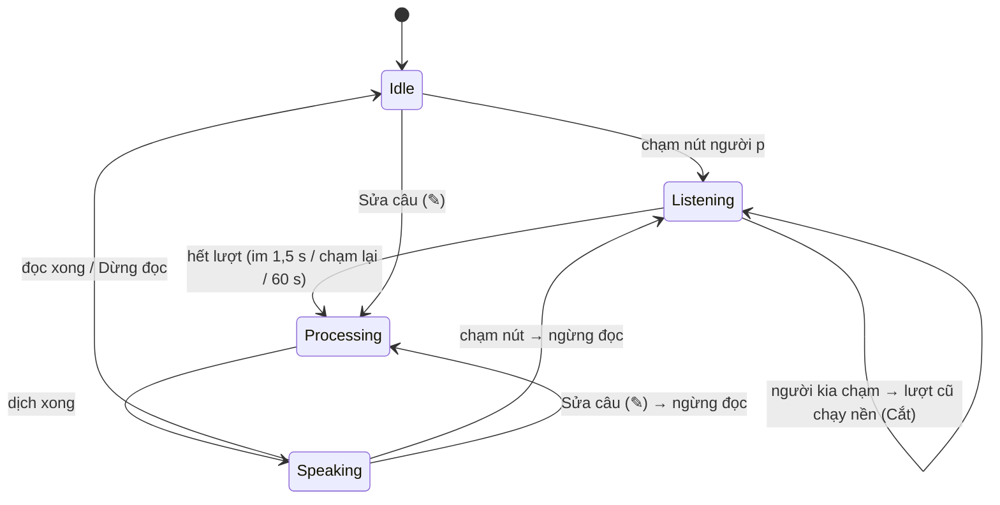

# DR-09 — Thu gọn app: chỉ một bản offline, bỏ các chức năng phụ

**Trạng thái:** đã chốt · **Ngày:** 2026-10-07 · **Người viết:** Đạt (Claude soạn) ·
**Liên quan:** thay thế một phần DR-01 (flavor, thanh điều hướng) và DR-05 (luân
phiên, Chờ, chia đôi); DR-06; DR-07

## 1. Bối cảnh & ràng buộc

Danh sách yêu cầu mới của người dùng (2026-10-07):

| Yêu cầu | Đã chốt |
|---|---|
| Xoá phần Thực nghiệm | Bỏ màn Thực nghiệm |
| Xoá luân phiên, chen lời | Bỏ công tắc Luân phiên và chip Chen lời; chỉ giữ cách Cắt |
| Xoá đa nhiệm | Bỏ bố cục chia đôi màn hình (nút ▤, "Xoay nửa trên") |
| Xoá dưới hội thoại | Bỏ thanh điều hướng dưới; thay bằng ngăn ☰ như ChatGPT |
| Đảm bảo toàn bộ app chạy offline | Bỏ bản `dev` (ML Kit); chỉ còn một bản, không có quyền Internet |
| Lưu lịch sử, tạo cuộc mới | DR-06 |
| Sửa câu sau khi gửi | Nút ✎ trên mỗi câu |
| STT nghe nhầm | Sửa bằng ✎ rồi dịch lại; Hướng dẫn có mẹo |

Ràng buộc: app nhẹ, dễ dùng cho hai người; không sửa Core.

## 2. Định nghĩa

- **Cắt:** người kia chạm nút của họ khi lượt hiện tại chưa xong thì lượt hiện tại
  vẫn được nhận dạng, dịch và lưu nhưng không đọc (nhãn "chưa phát"); micro chuyển
  sang người vừa chạm.
- **Sửa câu:** thay câu gốc của một câu đã gửi và dịch lại. Từ 2026-10-23 (chính sách rule dịch text v1, R13, DR-07 §16)
  câu sửa là chữ gõ nên không tự đọc lại; bấm 🔊 để nghe.

## 3. Quy trình hoạt động

## 4. Ứng viên

| Hạng mục | Giữ như cũ | Thu gọn (chọn) |
|---|---|---|
| Bản build | `offline` + `dev` (ML Kit, cần mạng tải gói) | Một bản, mô hình dịch Main-Core trong APK (DR-07) |
| Điều hướng | Thanh dưới 4–5 tab | Hội thoại là màn chính; ☰ chứa danh sách cuộc, Dịch nhanh, Hướng dẫn, Cài đặt |
| Chen lời | Cắt / Chờ chọn được, luân phiên tự động | Chỉ Cắt, người dùng tự chạm |
| Bố cục | Khung chat + chia đôi xoay nửa trên | Chỉ khung chat |
| Thực nghiệm | Màn riêng | Bỏ; phần đo máy chuyển vào Cài đặt → Kiểm tra máy này |

## 5. Tiêu chí

Đúng yêu cầu người dùng; app chắc chắn offline (kiểm được bằng quyền trong APK);
ít chế độ để hai người dùng lần đầu không phải chọn; ít mã cần bảo trì.

## 6. Ứng viên được chọn

Cột "Thu gọn" ở mục 4.

## 7. Lý do chọn & thiết kế tích hợp

- **Offline:** đã có mô hình dịch Main-Core (DR-07) nên bản `dev` không còn lý do
  tồn tại. Xoá `productFlavors`, `src/dev/`, `src/offline/` (manifest gộp vào `main`),
  thư viện ML Kit và `proguard-dev.pro`. `AndroidManifest.xml` xoá INTERNET và
  ACCESS_NETWORK_STATE bằng `tools:node="remove"` (kể cả quyền do thư viện kéo vào).
- **Chen lời:** `ConversationReducer` bỏ `pending`, `ConversationConfig` và cờ `auto`; chỉ
  còn Cắt. Thêm sự kiện `Edited` (sửa câu) và `Reset` (chuyển cuộc).
- **Giao diện:** `AppNav` không còn thanh dưới; `ConversationScreen` dùng
  `ModalNavigationDrawer` với `HistoryDrawer`. Xoá `SplitLayout.kt`,
  `ExperimentsScreen.kt`, `HistoryScreen.kt` và thư viện
  material3-adaptive-navigation-suite.
- **Sửa câu:** ✎ chỉ bật khi app rảnh hoặc đang đọc (không sửa khi đang nghe hoặc
  đang dịch câu khác); câu đã sửa có nhãn "đã sửa" và lưu vào lịch sử.
- **Đo máy:** `diagnostics/DeviceCheck` trong Cài đặt thay màn Thực nghiệm, phục
  vụ bảng thông số máy (`docs/bao_cao/thong_so_may_toi_thieu.md`).

## 8. Ưu điểm

- APK không có quyền Internet; một lệnh build duy nhất (`assembleRelease`).
- Màn chính đơn giản: hai nút nói, ⌨, ☰, ＋.
- Bớt hai thư viện (ML Kit, navigation-suite) và các file `SplitLayout`,
  `ExperimentsScreen`, `HistoryScreen`, `MlKitTranslator`, `FlavorTranslators`.

## 9. Nhược điểm & rủi ro

| Nhược điểm | Cách giảm |
|---|---|
| Bỏ chia đôi: hai người ngồi đối diện phải xoay máy để đọc | Hai bong bóng hai bên, chữ to; app đọc bản dịch thành tiếng |
| Bỏ luân phiên: mỗi lượt phải chạm nút | Nút lớn, tự dừng khi im 1,5 s |
| Bỏ Chờ: chạm nhầm sẽ cắt lượt người kia | Lượt bị cắt vẫn được dịch và lưu (nhãn "chưa phát"), bấm 🔊 để nghe |
| Các thí nghiệm TN-01…07 không còn chạy trong app | Kiểm tra máy trong Cài đặt; thí nghiệm khác làm ngoài app nếu cần |

## 10. Kiểm chứng

- `gradlew.bat testDebugUnitTest`: 61/61 test qua (reducer 15 test gồm sửa câu,
  chuyển cuộc và fuzz bất biến; `ConversationStoreTest`; `AppSmokeTest`).
- `gradlew.bat :app:assembleRelease "-Pvtt.abis=arm64-v8a,x86_64"`: APK arm64
  298,5 MB, x86_64 307,6 MB. `aapt2 dump permissions` APK arm64: chỉ
  `RECORD_AUDIO` (và quyền nội bộ `DYNAMIC_RECEIVER_NOT_EXPORTED_PERMISSION` do
  AndroidX tự thêm), không có INTERNET.

## 11. Nguồn

1. Yêu cầu của người dùng, 2026-10-07 (danh sách 5 mục xoá và 8 yêu cầu).
2. DR-01, DR-05, DR-06, DR-07 trong thư mục này.
