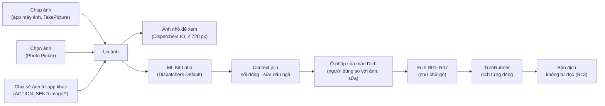

# DR-10 — Dịch ảnh: đọc chữ bằng ML Kit Text Recognition (mô hình đóng gói trong APK)

**Trạng thái:** đã chốt · **Ngày:** 2026-11-26 · **Người viết:** Đạt (Claude soạn) ·
**Liên quan:** DR-07 §16 (chính sách rule dịch text v1), DR-09 (một bản offline, không quyền Internet);
`ocr/`, `ui/translate/`, `Incoming.kt`; evidence `evidence/phase04/ocr_mlkit_v1/`

## 1. Bối cảnh & ràng buộc

Yêu cầu của người dùng (2026-11-26): "Làm tính năng OCR để tôi có thể dịch bằng hình ảnh", cùng với "tìm thêm chức năng
đơn giản mà đa dạng" để app dùng được trong nhiều tình huống. Trường hợp dùng chính: thông báo lỗi, màn hình cài đặt,
tài liệu kỹ thuật bằng tiếng Anh hoặc tiếng Việt (ảnh chụp màn hình hoặc ảnh chụp bằng điện thoại).

Ràng buộc (giữ từ DR-09 và kế hoạch app):

- Chạy offline hoàn toàn, không tải mô hình lần đầu, APK không có quyền Internet.
- Đọc đúng chữ tiếng Việt có dấu (đủ 178 chữ cái) và tiếng Anh.
- Không thêm quyền: chỉ `RECORD_AUDIO`.
- App nhẹ; minSdk 26; ABI arm64-v8a và x86_64.
- Chính sách rule dịch text v1: không tự sửa chữ của người dùng hay bản dịch (R01), chữ không giọng nói thì không tự
  đọc (R13).

## 2. Định nghĩa

- **OCR (nhận dạng chữ quang học):** tìm vùng có chữ trong ảnh rồi đọc từng dòng thành văn bản.
- **Khối (block), dòng (line):** ML Kit trả về các khối chữ (một đoạn, một tiêu đề, một nút), mỗi khối gồm các dòng
  theo cách chữ xuống dòng trong ảnh.
- **Bản đóng gói (bundled) và bản qua Google Play services (unbundled):** bản đóng gói mang mô hình trong APK. Bản
  unbundled tải mô hình qua Google Play services khi dùng lần đầu, nên cần mạng và máy phải có Play services.
- **CER:** số ký tự sai (khoảng cách Levenshtein) chia cho số ký tự đúng.

## 3. Quy trình hoạt động

1. Người dùng chạm **Chụp ảnh** hoặc **Chọn ảnh** ở màn Dịch, hoặc chia sẻ một ảnh sang app, hoặc dùng lối tắt
   **Dịch ảnh** ở biểu tượng app.
2. `ImageTextReader.read` giải mã ảnh (xoay theo EXIF, cạnh dài tối đa 3000 px), tạo bộ đọc ML Kit, đọc bitmap đó
   (`InputImage.fromBitmap`, nên toạ độ các khối là toạ độ trên chính ảnh này, dùng cho §12), rồi đóng bộ đọc.
3. `OcrText.join` biến các khối thành văn bản: các dòng của một khối nối bằng dấu cách (một câu bị xuống dòng trong ảnh
   là một câu); từ bị gạch nối ở cuối dòng được nối lại; mỗi khối một dòng; khối không có chữ hay số bị bỏ;
   trong khối tiếng Việt, chữ có hai chấm (ä, ö, ü…) đổi về chữ có dấu ngã.
4. Chữ vào ô nhập cùng ảnh nhỏ, số dòng và thời gian đọc; dòng nhắc "So với ảnh, sửa chữ trong ô nếu sai rồi bấm Dịch."
5. App dịch như chữ gõ. Chữ nhiều dòng được dịch từng dòng (`TurnRunner.translateLines`) để tiêu đề không bị ghép với
   đoạn văn.

## 4. Ứng viên

| Ứng viên | Phiên bản | License | Dung lượng thêm vào APK | Offline | Tiếng Việt | Số liệu (nguồn) |
|---|---|---|---|---|---|---|
| ML Kit Text Recognition v2, Latin, bản đóng gói (`com.google.mlkit:text-recognition`) | 16.0.1 | ML Kit Terms of Service | arm64 +13,1 MB: thư viện `.so` 11,1 MB, 21 file mô hình 1,5 MB (1,3 MB khi nén), phần còn lại là mã Java (mục 10) | có | có: nhóm "Supported" của bộ đọc Latin [1] | VI CER 0,7 %, EN 0 % trên 8 ảnh thử (`ocr_mlkit_v1`) |
| ML Kit Text Recognition v2 qua Google Play services (`play-services-mlkit-text-recognition`) | 19.0.x | ML Kit Terms of Service | nhỏ (mô hình không nằm trong APK) | không: tải mô hình qua Play services lần đầu [2] | có | không đo (loại vì cần mạng) |
| PaddleOCR PP-OCRv5 `latin_PP-OCRv5_mobile_rec` (+ mô hình tìm chữ) chạy bằng ONNX Runtime đã có trong app | v5 | Apache-2.0 | vài MB | có | **thiếu 90/178 chữ cái** (toàn bộ khối U+1EA0–U+1EF9: ạ, ế, ộ…) | `paddle_latin_dict_check.json` [3] |
| Tesseract (`vie.traineddata` + thư viện JNI như Tesseract4Android) | 4/5 | Apache-2.0 | vài MB mỗi ngôn ngữ + thư viện | có | có | không đo |

## 5. Tiêu chí

1. Offline, không tải gì sau khi cài, không thêm quyền (DR-09).
2. Đọc được đủ chữ cái tiếng Việt có dấu và tiếng Anh.
3. Đọc được cả ảnh chụp màn hình và ảnh chụp nghiêng, mờ (trường hợp dùng chính).
4. Ít mã phải tự viết và bảo trì (tìm vùng chữ, xoay, tách dòng).
5. Dung lượng thêm vào APK nhỏ so với APK hiện tại (khoảng 300 MB).

## 6. Ứng viên được chọn

ML Kit Text Recognition v2, mô hình Latin đóng gói trong APK: `com.google.mlkit:text-recognition:16.0.1` từ Google Maven
(khai báo trong `gradle/libs.versions.toml`).

## 7. Lý do chọn & thiết kế tích hợp

Theo tiêu chí:

1. **Offline:** mô hình và thư viện native nằm trong APK. Log trên emulator có Play services (đã tải sẵn module OCR của
   Play) cho thấy ML Kit chọn bản trong APK: "Selected local version of com.google.mlkit.dynamite.text.latin", thư viện
   nạp từ `base.apk` (`bundled_model_logcat.txt`). Chế độ máy bay bật khi đo. Khác với ML Kit Translate bị bỏ ở DR-09:
   Translate phải tải gói ngôn ngữ qua mạng, còn bản đóng gói của Text Recognition không tải gì.
2. **Tiếng Việt:** Vietnamese (`vi`) thuộc nhóm "Supported" của bộ đọc Latin, tức ngôn ngữ Google ưu tiên và đánh giá
   thường xuyên [1]; đo trên bộ ảnh thử: 2 lỗi trên 290 ký tự.
   PaddleOCR Latin bị loại vì không thể in ra 90 chữ cái tiếng Việt.
3. **Ảnh chụp:** ML Kit tự tìm vùng chữ, xoay theo EXIF và tách khối, dòng; hai ảnh kiểu chụp điện thoại (nghiêng 3,5°,
   mờ, nhiễu) đọc đúng sau khi sửa dấu ngã.
4. **Ít mã:** app chỉ viết `OcrText` (nối dòng, 60 dòng) và `ImageTextReader` (gọi ML Kit, ảnh xem trước, Uri ảnh chụp).
   PaddleOCR hay Tesseract cần tự làm phần tìm vùng chữ, xoay ảnh, tách dòng.
5. **Dung lượng:** APK arm64 tăng 13,1 MB (4,4 %, mục 10).

Thiết kế tích hợp:

| Phần | File | Ghi chú |
|---|---|---|
| Thư viện | `gradle/libs.versions.toml`, `app/build.gradle.kts` | `mlkit-text-recognition` 16.0.1 |
| Đọc ảnh | `ocr/ImageTextReader.kt` | Tạo bộ đọc cho mỗi ảnh rồi `close()`, không giữ RAM giữa các lần dùng; chạy trên `Dispatchers.Default`; ảnh xem trước ≤ 720 px |
| Văn bản cho bộ dịch | `ocr/OcrText.kt` | Nối dòng trong khối, nối từ gạch nối, bỏ khối toàn ký hiệu, `repairTildes`; chỉ chuẩn hoá theo `MtInputNormalizer` (R01), không sửa chính tả, không đổi hoa thường |
| Giao diện | `ui/translate/TranslateScreen.kt`, `TranslateViewModel.kt` | Nút **Chụp ảnh** / **Chọn ảnh** hai bên nút micro; pha `READING_IMAGE`; ảnh nhỏ + "Đọc được N dòng chữ (X ms)" + nút bỏ ảnh; chữ dài hơn 500 ký tự (R02) vào ô nhưng chưa dịch |
| Quyền | `AndroidManifest.xml`, `res/xml/file_paths.xml` | Photo Picker (`PickVisualMedia`) không cần quyền đọc ảnh; chụp bằng app máy ảnh qua `TakePicture` + `FileProvider` (`cache/photos/`, chỉ giữ ảnh mới nhất) nên không cần quyền CAMERA |
| Lối vào | `Incoming.kt`, `MainActivity.kt`, `res/xml/shortcuts.xml` | Nhận ảnh chia sẻ (`ACTION_SEND image/*`) và lối tắt "Dịch ảnh" (mở bộ chọn ảnh) |
| Dịch nhiều dòng | `turn/TurnRunner.kt` | Mỗi dòng một lần dịch, ghép lại bằng xuống dòng; kiểm tra R08/R12 trên toàn bộ |
| R8 | `app/proguard-rules.pro` | `-keep class com.google.mlkit.**.*Registrar { <init>(); }`: ML Kit tạo registrar bằng reflection theo tên trong manifest; thiếu rule này bản release văng `NoSuchMethodException` ở ảnh đầu tiên |
| Kiểm APK | `tools/check_apk.py` | Mục `ocr`: bắt buộc có `libmlkit_google_ocr_pipeline.so` và mô hình Latin trong `assets/mlkit-google-ocr-models/`; các file `.tflite` ở đó không bị báo là model lạc chỗ |

## 8. Ưu điểm

- Dịch được chữ không gõ lại được (thông báo lỗi, ảnh tài liệu), offline, không thêm quyền.
- Đọc chữ dưới 1 s với ảnh màn hình trên emulator.
- Chữ đọc được luôn hiện trong ô để người dùng kiểm tra trước khi tin bản dịch.
- Không đụng tới gói MT và các rule; ảnh đi đúng đường của chữ gõ.

## 9. Nhược điểm & rủi ro

| Nhược điểm / rủi ro | Cách giảm hoặc phát hiện |
|---|---|
| Sai một dấu thanh làm bản dịch sai hẳn ("kết nôi tới máy chủ" → "Could not close temporary folder: %s") | Dòng nhắc so chữ với ảnh; lỗi thường gặp trong Hướng dẫn. Không tự sửa dấu thanh vì "nôi" là một từ thật (R01) |
| Dấu ngã đọc thành hai chấm ("Häy") | `OcrText.repairTildes`, chỉ trong khối có chữ cái riêng của tiếng Việt; test `umlautReadForAVietnameseTildeIsRepaired` |
| Chữ nhỏ trong ảnh chụp màn hình đọc sai nhiều ("Hội thogi") | Hướng dẫn: chụp gần, thẳng, đủ sáng |
| ML Kit là mã đóng của Google, theo ML Kit Terms (không phải giấy phép mã nguồn mở) | Ghi trong `docs/licenses.md` và mục Giấy phép của Hướng dẫn; app phi thương mại |
| ML Kit có thư viện ghi số liệu dùng (`datatransport`) | APK không có quyền Internet (`check_apk.py` kiểm), nên không gửi được gì ra ngoài |
| APK lớn hơn | Đo trong mục 10; vẫn một APK cho mỗi ABI |
| Chưa đo trên điện thoại thật | Đo khi có máy (Cài đặt → Kiểm tra máy này chưa gồm OCR); số của emulator chỉ là kiểm tra chức năng |

## 10. Kiểm chứng

- Bộ ảnh thử và chấm điểm: `python tools/ocr/make_test_images.py evidence/phase04/ocr_mlkit_v1`, đọc từng ảnh trong app
  (lối tắt Dịch ảnh → bộ chọn ảnh), `python tools/ocr/score_ocr.py evidence/phase04/ocr_mlkit_v1`:
  `OCR_SCORE lang=vi pictures=4 chars=290 cer=0.7%`, `OCR_SCORE lang=en pictures=4 chars=320 cer=0.0%`.
- Bản mô hình được dùng: `evidence/phase04/ocr_mlkit_v1/bundled_model_logcat.txt` (Chế độ máy bay, emulator có Play services).
- Test JVM: `OcrTextTest` (7 test: nối dòng, khối, gạch nối, khối ký hiệu, R01, sửa dấu ngã, ảnh không có chữ),
  `IncomingTest` (chữ, ảnh chia sẻ, lối tắt).
- `tools/check_apk.py`: mục `ocr` PASS trên APK arm64-v8a và x86_64; test `test_ocr_models_are_required_and_not_leftovers`.
- Test JVM toàn bộ: 108/108 qua (2026-11-26). Test tool Python: 43 test, 1 bỏ qua.
- Dung lượng (`ls -l`, `zipfile`): APK arm64-v8a 308 507 883 B, x86_64 318 612 436 B; bản trước khi có Dịch ảnh
  (2026-10-24) 295 432 225 B và 304 979 725 B, tức tăng 13,1 MB và 13,6 MB. Trong APK arm64:
  `libmlkit_google_ocr_pipeline.so` 11 064 544 B (x86_64: 11 626 128 B), `assets/mlkit-google-ocr-models/` 21 file,
  1 486 803 B (nén 1 272 325 B).

## 11. Nguồn

1. ML Kit, Text recognition v2, danh sách ngôn ngữ hỗ trợ (Latin): <https://developers.google.com/ml-kit/vision/text-recognition/v2/languages>
2. ML Kit, Text recognition v2 trên Android, bản đóng gói và bản qua Google Play services: <https://developers.google.com/ml-kit/vision/text-recognition/v2/android>
3. PaddleOCR `latin_PP-OCRv5_mobile_rec`: <https://huggingface.co/PaddlePaddle/latin_PP-OCRv5_mobile_rec> (bộ ký tự trong `inference.yml`, kiểm ngày 2026-11-26)
4. ML Kit Terms of Service: <https://developers.google.com/ml-kit/terms>
5. Yêu cầu của người dùng, 2026-11-26.

## 12. Bổ sung 2026-11-26: dịch trên ảnh

Người dùng hỏi: "Sao OCR không dịch bên trên ảnh mà chỉ chuyển sang chữ xong dịch thế thôi à?" Quyết định ở mục 6 giữ
nguyên. Phần này chỉ thêm cách hiện kết quả.

**Hai cách làm đã xét:**

| Cách | Làm được offline trên máy yếu? | Chọn |
|---|---|---|
| Dịch trực tiếp trên khung máy ảnh (AR, như Google Lens chế độ trực tiếp) | Không: mỗi khung hình cần đọc chữ (0,7–2,1 s trên emulator, bảng §10) cộng dịch từng khối (157–215 ms/câu trên emulator, điện thoại chậm hơn 2–5 lần); muốn mượt phải dưới khoảng 200 ms/khung | Không |
| Vẽ bản dịch lên ảnh tĩnh vừa chụp hoặc chọn (như chế độ "Quét" / ảnh của các app dịch) | Có: chỉ thêm một lần vẽ ảnh sau khi dịch xong, không phải mỗi khung hình | **Có** |

**Cách làm** (`ocr/ImageOverlay.kt`, `OcrText.place`, `OcrText.linesForBlocks`, `OverlayColors`):

1. Khi đọc ảnh, app tự giải mã ảnh (xoay theo EXIF, cạnh dài tối đa 3000 px) rồi đưa bitmap đó cho ML Kit. Toạ độ 4 góc
   của từng khối và chiều cao từng dòng vì thế là toạ độ trên chính ảnh này. App giữ một bản tối đa 2048 px.
2. Ô nhập có mỗi khối một dòng, và `TurnRunner` dịch từng dòng. Vì vậy dòng i của bản dịch là bản dịch của khối i.
   Người dùng sửa chữ trong một dòng vẫn ghép được; gộp hay tách dòng thì không ghép được nữa, khi đó app ghi chú dưới thẻ.
3. Cách vẽ mỗi khối:
   - **Màu:** màu nền là trung vị các điểm ảnh gần độ sáng trung vị của khung; màu chữ là trung bình 10 % điểm ảnh khác
     nền nhất (đủ tương phản thì dùng, không thì dùng đen hoặc trắng).
   - **Vùng phủ:** nới khung ra hai bên và lên xuống, chừng nào dải sát khung còn mực. Khung của ML Kit có thể cắt mép
     chữ đầu hoặc bỏ sót dấu chấm cuối. Mép vùng phủ được làm mờ để không hiện thành hình chữ nhật trên ảnh chụp.
   - **Cỡ chữ:** đo chính dòng chữ gốc bằng font vẽ ở 100 px, rồi quy theo chiều cao khung dòng ML Kit trả về (lấy trung
     vị các dòng). Khung dòng chỉ cao bằng nét chữ, nên dòng không có chữ thò xuống (g, p, y) hay dấu có khung thấp hơn,
     và cách đo này tính được cả trường hợp đó. Chữ xoay theo góc của khối.
   - **Dòng:** bản dịch giữ số dòng như bản gốc, cách dòng như bản gốc, căn giữa theo khối. Bản dịch dài hơn thì được
     tràn sang nền trống bên phải (tối đa thêm 60 %), sau đó mới thu nhỏ chữ (đến 55 %), cuối cùng mới cho khối dài xuống.
4. Thẻ **Bản dịch trên ảnh** có các nút Ảnh dịch / Ảnh gốc, xem toàn màn hình (chụm ngón để phóng to) và chia sẻ ảnh
   (JPEG lưu trong `cache/shared/` qua `FileProvider`).

**Kiểm chứng** (`evidence/phase04/ocr_overlay_v1/`, AVD, Chế độ máy bay): 8/8 ảnh thử có ảnh dịch. Chữ trong ô giống
hệt lần đo §10 (app nay tự giải mã ảnh rồi đưa bitmap cho ML Kit). Ảnh so sánh (ảnh gốc / ảnh dịch) cho thấy:
- Bản dịch đặt đúng chỗ.
- Ảnh chụp nghiêng 3,5° được vẽ nghiêng theo.
- Chiều Anh→Việt hiện đủ dấu.

Hai lần chỉnh sau khi xem ảnh:
1. Bản đầu còn sót mép chữ gốc (vạch của chữ "V", dấu chấm cuối) và lộ viền mảng phủ trên ảnh chụp. Sửa bằng cách nới
   vùng phủ theo mực, lấy màu nền bằng trung vị và làm mờ mép.
2. Tiêu đề bị vẽ nhỏ hơn bản gốc, và câu "Không thể kết nối tới máy phục vụ." bị vẽ rất nhỏ (dòng gốc không có chữ
   thò xuống). Sửa bằng cách tính cỡ chữ như trên, giữ số dòng, và cho chữ tràn sang nền trống.

**Giới hạn:**
- Chữ trên nền nhiều hoa văn hoặc ảnh phong cảnh được phủ bằng một màu phẳng.
- Kiểu chữ luôn là font hệ thống (không đậm, nghiêng như bản gốc).
- Khối có nhiều dòng được vẽ lại theo cách xuống dòng của bản dịch.
- Bản dịch sai (ví dụ do đọc sai dấu thanh "kết nôi") cũng được vẽ lên ảnh: người dùng vẫn phải so chữ trong ô.

Test JVM: `OcrTextTest` thêm 3 test (`place`, `linesForBlocks`, `OverlayColors`), toàn bộ 111/111.
